# Chunk Lab 操作手册

> 适用对象：使用 XShipAI 工作台完成电商文档解析、切分、人工审阅与向量入库的运营、标注和内容同学。  
> 适用版本：Chunk Lab v0.1.47（界面实测于 2026-11-10）。  
> 访问入口：`http://203.0.113.10:18184/`，从 XShipAI 工作台桌面点击 **Chunk Lab** 进入。  
> 账号与密码请向管理员获取，本文不记录任何登录凭据。

---

## 0. 读完这份手册，你能做什么

- 把 PDF、Word、PPT、Excel、图片、Markdown 或 TXT 变成可追溯的 Chunk。
- 用 6 种切分策略生成 Preview，读懂质量指标并判断结果是否可用。
- 把 Preview 转成 Draft，逐块修订文字、类型、表格和图片策略。
- 给 Chunk 补充 Context，审核图片摘要，建立表格与文字块的检索关系。
- 把资料归属到 SPU，按 SPU 生成 Markdown 和 Manifest。
- 完成 Embedding、写入 pgvector，并用 Recall@K 做一次检索验证。
- 导出 JSON、Manifest 或 SPU 资料，交付给下游。

这篇手册按“先跑通一次，再逐项深入”的顺序编排。第一次使用建议先看第 1、2、4 章，照着第 4 章走一遍；之后遇到具体功能再查对应章节。

---

## 1. 平台入口与工作台

### 1.1 XShipAI 工作台是什么

XShipAI 是一个应用桌面。登录后进入“应用程序”窗口，当前部署包含 6 个应用：

| 应用 | 副标题 | 与本手册的关系 |
| --- | --- | --- |
| 训推平台 | 数据、训练与模型 | 模型与训练相关，本手册不展开 |
| ComicFlow | 让故事成为画面 | 漫画/图像创作，本手册不展开 |
| PicAgent | 商品图片创作室 | 商品图创作，本手册不展开 |
| **Chunk Lab** | **整理你的知识素材** | **本手册的主角：电商文档审阅台** |
| 智能检索 | 每个回答都有依据 | 消费 Chunk Lab 入库后的知识，可从 Chunk Lab 的“检索验证”跳转 |
| 商境 | 电商内容智能创作 | 电商内容生产，本手册不展开 |

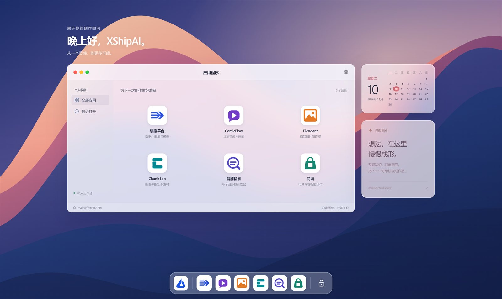

桌面上的操作：

| 操作 | 位置/方式 | 说明 |
| --- | --- | --- |
| 打开应用 | 点击应用卡片 | 在桌面内以窗口打开，窗口右上角可在新标签页打开 |
| 搜索应用 | 顶部放大镜，或 `Ctrl/⌘ + K` | 按应用名称、副标题或 ID 搜索 |
| 全部应用 / 最近打开 | 左侧“个人收藏” | 切换应用列表 |
| 关闭 / 最小化 / 最大化 | 窗口左上角三个圆点 | 关闭只关闭窗口，不退出登录 |
| 重新加载应用 | 窗口右上角刷新图标 | 应用无响应时使用 |
| 锁定并退出 | 右上角用户菜单，或 Dock 右侧锁图标 | 退出登录并回到登录页 |

### 1.2 登录

1. 打开管理员提供的地址，未登录时会跳转到登录页。
2. 默认使用 **账号登录**：输入账号和密码，点击 **进入工作台**。
3. 如果管理员已配置飞书，也可以切换到 **飞书扫码**，仅限指定飞书群成员。
4. 登录成功后进入应用桌面。关闭浏览器不会立即退出；需要退出时使用“锁定并退出登录”。

注意：

- 登录凭据只保存在你自己的密码管理器里，不要写进文档、截图或群里。
- 同一浏览器会记住最近打开的批次和历史文件；清除站点数据后，这些入口会消失，服务端的批次仍可能在 24 小时临时工作区内。

### 1.3 进入 Chunk Lab

在桌面点击 **Chunk Lab**。应用标题为“Chunk Lab / 电商文档审阅台”，界面语言为中文。

如果点击后提示需要从桌面打开，请回到工作台重新点击应用卡片，不要直接复制应用端口地址并在新标签页打开；应用启动需要工作台先完成一次启动授权。

---

## 2. 先理解这套流程

### 2.1 主流程

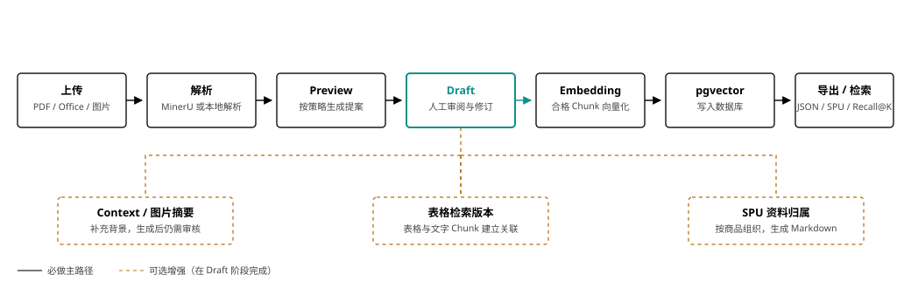

一条最小的可用链路是：

**上传 → 解析 → 切分 Preview → 采用为 Draft → 人工修订 → Embedding → 写入数据库 → 导出或检索验证。**

其中 Context Enhancement、图片摘要、表格检索版本、SPU 资料归属属于可选增强。它们影响下游检索质量和资料组织方式，但不是每次都必须做。

### 2.2 六个必须记住的原则

1. **原文不可变。** 人工修改发生在 Draft 和人工标注层，不会改写 Source Document 和 Parsed Document。
2. **Preview 不是结果。** Preview 是可重新生成的提案；采用后才成为 Draft。
3. **每份文档独立。** 同一批次里一份文档失败，不会阻止其他文档继续审阅。
4. **来源必须可追溯。** 每个 Chunk 要能回到页码、来源框或 Source Segment。
5. **模型结果必须审核。** 图片摘要和 Context 不会因为生成成功就自动成为最终结论。
6. **先保存，再做下游。** 修改 Chunk、图片摘要或 Context 后，等保存状态完成，再执行 Embedding、入库或导出。

### 2.3 核心概念

| 概念 | 一句话解释 | 在界面上的位置 |
| --- | --- | --- |
| Source Document | 你上传的原始文件 | 左栏文件名、原文区“原始文件/源码” |
| Parsed Document | 解析器对原文的结构化结果 | 原文区“解析结果” |
| Content Block | 解析结果中的最小内容单元，如标题、段落、表格、图片 | 解析结果中的每一段 |
| Content Group | 需要保持在一起的内容组，如表格、图片+图注 | 解析/切分内部使用 |
| Preview | 按当前配置生成、尚未采用的 Chunk 提案 | 右侧 Preview 标签页 |
| Draft | 采用 Preview 后、可人工修订的 Chunk 集合 | 右侧 Draft 标签页 |
| Source Segment | Chunk 到原文的定位记录，含页码、bbox、文本范围、重叠标记 | 详情面板底部 |
| Context Enhancement | 附加在 Chunk 外的 2-4 句背景说明 | 详情面板 Context 区 |
| SPU | 标准商品单元，资料按商品组织 | “分配资料归属”对话框 |
| Embedding | 把 Chunk 转成向量 | “生成 Embedding”/“向量化并入库” |
| pgvector | 保存向量并支持相似度检索的数据库 | “写入数据库”对话框 |

---

## 3. 界面总览

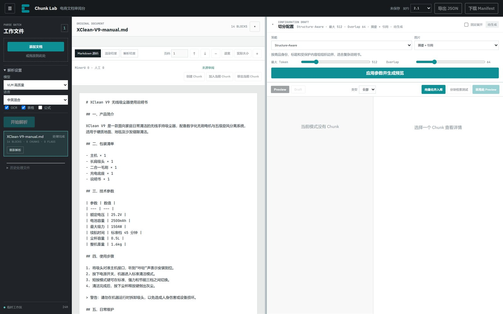

界面分为四个区域：

| 区域 | 位置 | 作用 |
| --- | --- | --- |
| 顶栏 | 页面顶部 | 保存状态、契约版本、导出 JSON、下载 Manifest |
| 工作文件 | 左侧 | 添加文档、解析设置、开始解析、切换文件、历史文件、诊断包 |
| 原文区 | 中间 | 查看原始文件或解析结果、翻页缩放、核对来源、人工标注 |
| Chunk 审阅区 | 右侧 | 切分配置、质量指标、Preview/Draft、Chunk 列表与详情 |

### 3.1 顶栏

- **保存状态**：显示“未保存”“已保存并重算”“人工 Context 已保存”等。它反映最近一次操作是否落到服务端，不是自动保存开关。
- **契约**：导出格式，默认 `2.1`，只有下游明确要求旧格式时才选 `Legacy`。
- **导出 JSON**：导出当前批次中已有 Draft 的文档。
- **下载 Manifest**：只下载批次清单和统计，不包含完整 Chunk 正文。

### 3.2 工作文件栏

- **添加文档**：选择文件，或把文件拖到上传区。
- **解析设置**：模型、语言、OCR、表格、公式。
- **开始解析**：把当前待上传文件提交为一个 Parse Batch。
- **文件列表**：显示文件名、状态、Block 数、Chunk 数、Quality Flag 数。
- **历史处理文件**：当前浏览器打开过的批次，最多保留 50 条，每页 5 条。
- **临时工作区 24H**：页面底部提示，正式结果请在有效期内导出。

点击左上角 `☰` 可以收起/展开文件栏；左右两栏之间的分隔条可以拖动，双击恢复默认宽度。

### 3.3 原文区

- 来源视图标签：不同文件类型显示不同视图。
- 页码、上一页、下一页、缩小、适宽、实际大小、放大。
- 来源审阅工具：创建 Chunk、加入当前 Chunk、移出当前 Chunk。
- 人工标注工具：只在“人工框选切分”策略下可用。
- 右上角 `×`：清除来源锁定。

### 3.4 Chunk 审阅区

从上到下依次是：

1. **切分配置**：策略、图片策略、参数、生成预览。
2. **质量指标**：分块数、Token、重叠、过短/超长等。
3. **模式栏**：Preview / Draft 切换、类型筛选、下游动作。
4. **Context / 审阅进度工具条**：只在 Draft 中显示。
5. **Chunk 列表**：左侧卡片。
6. **详情面板**：右侧当前 Chunk 的编辑、SPU 归属、Context、Source Segments。

---

## 4. 五分钟跑通一次

以下以一份结构清晰的说明书为例。

1. **添加文档**：点击“添加文档”，选择一个 PDF/Word/Markdown 文件；也可以拖入上传区。
2. **确认解析设置**：扫描件打开 OCR；有表格打开“表格”；有公式再打开“公式”；中文资料选“中英混合”。
3. **开始解析**：点击“开始解析”，等待文件状态从“上传中/排队/解析中”变为“处理完成”。
4. **检查原文**：在中间区域切换“原始文件/解析结果”，翻几页，确认标题、表格、图片和阅读顺序没有明显错位。
5. **选择策略**：右侧“切分配置”选择 `Structure-Aware`，最大 Token 先用 `512`，Overlap 先用 `64`；图片策略先用“摘要 + 引用”。
6. **生成 Preview**：点击“应用参数并生成预览”。等待右侧出现 Chunk 卡片和质量指标。
7. **检查质量**：先看“切分判断”和“过短/超长”，再抽查 3-5 个 Chunk 的正文、类型和 Source Segments。
8. **采用 Preview**：点击“采用此 Preview”。如果已有 Draft，会提示替换影响；确认后进入 Draft。
9. **修订 Draft**：选中 Chunk，点击“编辑”，修正文字和类型；必要时拆分、合并、排除。
10. **按需增强**：处理图片摘要、Context、表格检索关系；需要按商品交付时确认 SPU 归属。
11. **向量化并入库**：点击“向量化并入库”，选择 Embedding 模型和目标数据库，依次完成切分、向量化、入库。
12. **验证与导出**：用“分块检索测试”看 Recall@K；确认无误后导出 JSON，或按 SPU 生成 Markdown。

> 如果只是内部试跑、不要求人工审阅，可以在第 4 步后直接点“向量化并入库”。它会自动完成切分、采用 Preview、向量化和入库，但不会替你审核内容。正式交付仍建议走完整审阅链路。

---

## 5. 上传与解析

### 5.1 支持的文件

| 类型 | 扩展名 | 解析方式 | 来源定位特点 |
| --- | --- | --- | --- |
| PDF | `.pdf` | MinerU 云端解析 | 页码 + bbox，最适合逐框核对 |
| Word | `.docx` | MinerU + Visual Copy | 解析结果 + 版面对照，复杂浮动对象需复核 |
| PowerPoint | `.pptx` | MinerU + Visual Copy | 按幻灯片页审阅，注意阅读顺序 |
| Excel | `.xlsx` | MinerU + Visual Copy | 重点检查表头、合并单元格、行组 |
| 图片 | `.png` `.jpg` `.jpeg` | MinerU | 单页图片，可作为图片 Chunk |
| Markdown | `.md` | 本地解析 | 只有文本和结构，没有页面 bbox |
| 纯文本 | `.txt` | 本地解析 | 只有文本范围，没有页面 bbox |

不要把文件扩展名改成一个不匹配的格式，解析器会按真实内容判断。

### 5.2 解析设置


| 设置 | 选项 | 什么时候用 |
| --- | --- | --- |
| 模型 | `VLM 高质量` / `Pipeline` | 复杂版面、图文混排优先 VLM；常规文档可用 Pipeline |
| 语言 | `中英混合` / `英文` | 中文或中英混排选前者；纯英文选后者 |
| OCR | 开/关 | 扫描 PDF、图片文字无法直接提取时打开 |
| 表格 | 开/关 | 需要保留表格结构时打开，默认开 |
| 公式 | 开/关 | 技术文档、数学公式时打开，默认关 |

解析设置只作用于本次提交。需要换一套设置时，另建批次，或在确认影响后对单份文档“重新解析”。

### 5.3 文件状态

| 状态 | 含义 | 你该做什么 |
| --- | --- | --- |
| 待解析 | 文件只在浏览器待提交列表 | 设置好后点“开始解析” |
| 上传中 | 正在提交原文件 | 保持页面打开，不要重复点击 |
| 排队 | 服务端已接收，等待解析 | 等待；其他文件可独立推进 |
| 解析中 x/y | 正在处理，已提取 x/y 页 | 等待，大文件会更久 |
| 处理完成 | Parsed Document 可用 | 点击文件进入审阅 |
| 已复用 | 命中了相同内容 + 相同配置的解析缓存 | 直接审阅，必要时抽查来源 |
| 失败 | 当前文档未完成解析 | 看错误说明，下载诊断包，确认原因后重试 |

### 5.4 重新解析与诊断包

- 文档已完成时，文件行会出现“重新解析”。如果已有 Preview/Draft，页面会警告：重新解析会清除旧 Parsed Document、Preview、Draft、Revision 和 Context。
- 文档失败时，按钮显示“重试”。它只作用于当前文档。
- 出现解析失败、MinerU 结果异常、bbox/页码异常或 Visual Copy 失败时，文件行会出现“下载诊断包”。点击一次，等待“已下载”。

诊断包用于排查问题，不要直接当作交付物，也不要在里面写入密钥。

### 5.5 临时工作区

左下角显示“临时工作区 24H”。含义是：

- 上传与解析结果属于临时工作数据，请在有效期内完成审阅和导出。
- 需要长期保留的内容，导出 JSON/Manifest 或 SPU Markdown。
- 同一浏览器会记住最近批次；换浏览器、清理站点数据后，历史入口可能消失。

---

## 6. 查看原文与来源定位

### 6.1 来源视图

不同文件类型显示不同标签：

| 视图 | 出现条件 | 用途 |
| --- | --- | --- |
| 原始文件 | PDF、PNG、JPG | 看原页面，核对 bbox |
| Visual Copy | DOCX、PPTX、XLSX | 看转换后的版面对照 |
| Markdown 源码 | `.md` | 看原始 Markdown |
| 渲染结果 | `.md` | 按解析 Block 看渲染文本 |
| TXT 源码 | `.txt` | 看纯文本 |
| 解析结果 | 所有完成解析的文档 | 看 Content Block、类型和规范化状态 |

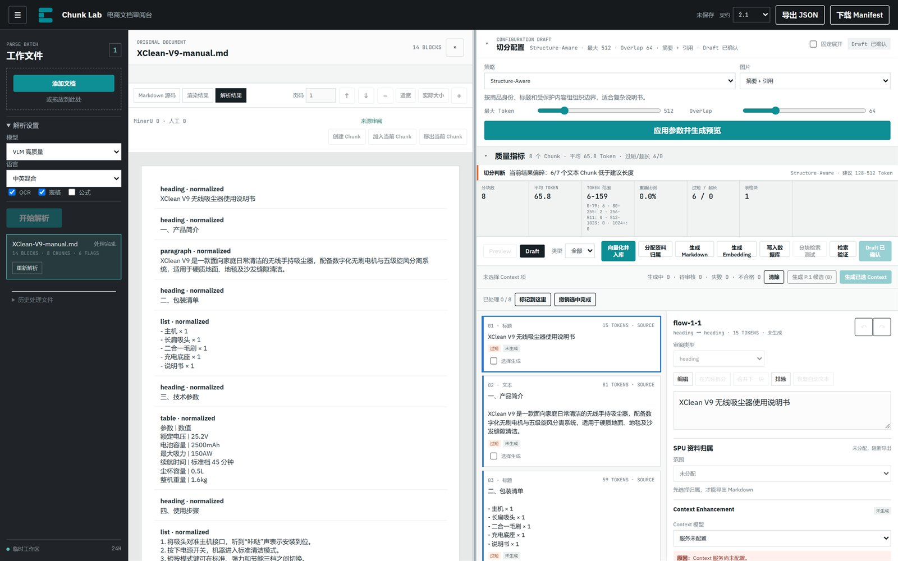

Markdown/TXT 没有页面坐标，因此人工框选、bbox 高亮和跨页合并不适用；这类文件主要靠 Chunk 文本和 Source Segment 的字符范围核对。

### 6.2 翻页与缩放

- 页码按钮：`P.1`、`P.2`……点击跳转。
- `页码`输入框：输入数字回车。
- `↑`/`↓`：上一页/下一页。
- `−`/`+`：缩小/放大。
- `适宽`：页面宽度适配可视区。
- `实际大小`：按原始比例显示。

PDF 采用窗口化渲染，只渲染当前页附近几页；滚动时页码会自动更新。

### 6.3 双向定位

- 点击 Chunk 卡片：原文区跳到它的第一个来源位置并高亮来源框。
- 点击原文中的蓝色来源框：Chunk 列表定位到引用它的 Chunk。
- 按住 `Ctrl`（Mac 为 `⌘`）点击：累加选择多个来源。
- 点击详情面板的 `Source Segments`：同样可以跳回原文。
- 点击原文区右上角 `×`：清除来源锁定。

`OVERLAP` 表示这个来源片段同时被相邻 Chunk 重叠引用，是切分参数产生的正常现象，不是重复内容错误。

如果提示“所选来源暂无对应 Chunk”，说明当前 Preview/Draft 没有引用这个来源：它可能被排除、只存在于人工标注层，或需要重新生成 Preview。

---

## 7. 切分配置

### 7.1 六种策略

| 策略 | 适用场景 | 参数 | 特点 |
| --- | --- | --- | --- |
| **Structure-Aware** | 大多数商品说明书、章节清晰的文档 | 最大 Token、Overlap | 按商品身份、标题和受保护内容组组织边界；默认首选 |
| **SentenceSplitter** | 连续自然语言、段落型说明 | 最大 Token、Overlap | 优先保留完整句子，可能偏短 |
| **TokenTextSplitter** | 需要稳定 Token 尺寸、结构要求弱 | 最大 Token、Overlap | 尺寸最直接，可能在语义边界附近切开 |
| **Semantic Boundary** | 主题切换明显、长文 | Buffer、断点 %、最大 Token | 用相邻句子窗口的语义距离找断点；超长结果按完整句子回退 |
| **父子分块** | 长文档、需要“子块检索、父块回填” | 父块 Token、子块 Token、子块重叠 | 子块用于向量检索，命中后返回父块上下文 |
| **人工框选切分** | 版面复杂、自动检测错误明显 | 无统一 Token 参数 | 以 MinerU 框为起点逐页修订，控制最精确，工作量最大 |

默认值（实测界面）：

| 策略 | 默认参数 |
| --- | --- |
| Structure-Aware | 最大 Token `512`，Overlap `64` |
| SentenceSplitter | 最大 Token `512`，Overlap `64` |
| TokenTextSplitter | 最大 Token `512`，Overlap `64` |
| Semantic Boundary | Buffer `1`，断点 `90%`，最大 Token `768` |
| 父子分块 | 父块 `1536`，子块 `384`，子块重叠 `64` |

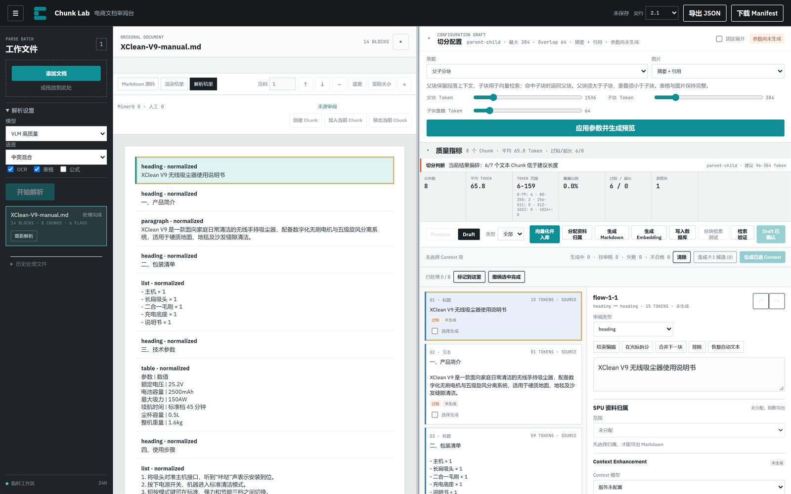

### 7.2 参数怎么调

- **最大 Token**：文本 Chunk 的目标上限。说明书通常 512 起步；技术参数密集的文档可调到 768-1024。
- **Overlap**：相邻 Chunk 的重叠 Token，必须小于 Chunk 大小。问答型检索可用 64；需要更强上下文连续性时加到 96-128。
- **Buffer**：语义断点比较时，当前句子前后各取几句组成窗口。1-2 足够。
- **断点 %**：阈值越高，断点越少、块越大。90 是保守起点。
- **父块 Token**：父块必须大于子块；父块用于回填，子块用于检索。
- **子块重叠**：必须小于子块 Token。

调参后配置会标记为“参数尚未生成”，旧 Preview 失效。必须点击“应用参数并生成预览”才会更新。

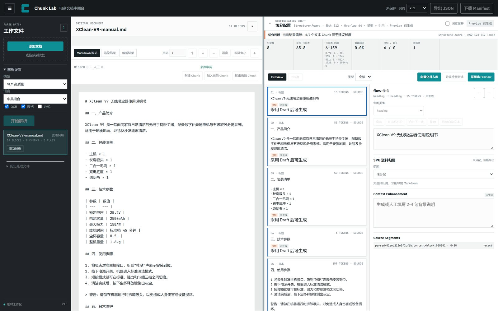

### 7.3 图片策略

| 策略 | 结果 | 适用 |
| --- | --- | --- |
| 摘要 + 引用 | 图片保留对象引用，需要人工审核摘要；摘要作为图片检索文本 | 图片本身承载商品信息，需要被检索 |
| 仅引用 | 不生成图片摘要，必须关联至少一个同文档的有效文字 Chunk | 图片只是正文的配图，靠正文检索 |
| 排除 | 图片不进入有效下游检索 | 装饰图、水印、无关图片 |

图片策略在“切分配置”里是默认值；进入 Draft 后，可以在单个图片 Chunk 中改。仅引用必须至少关联一个文字 Chunk，否则保存会被阻止。

### 7.4 配置草稿与预览失效

切分配置有三层状态：

1. **配置草稿**：你当前选的策略和参数。
2. **Preview**：按某一版配置生成的结果。
3. **Draft**：采用 Preview 后形成的可修订结果。

当你改了参数但还没重新生成时：

- 配置区显示“参数尚未生成”。
- 旧 Preview 标记为过期。
- “采用此 Preview”按钮变成“请先生成新 Preview”。

这是为了避免“用旧结果配新参数”。不要绕过它。

---

## 8. Preview 与质量指标

### 8.1 生成 Preview

自动策略点击 **应用参数并生成预览**。生成期间：

- 按钮禁用，配置区显示“生成中”。
- 右侧 Chunk 列表暂时不可用。
- 完成后自动切到 Preview 标签。

生成失败时，错误框按“原因 / 影响 / 下一步”显示。先按下一步处理，不要连续点击。

### 8.2 质量指标怎么看


| 指标 | 含义 | 判断 |
| --- | --- | --- |
| 分块数 | 当前 Preview 的 Chunk 总数 | 与文档章节数、页数对比，过多可能偏碎 |
| 平均 TOKEN | 每个 Chunk 的平均 Token | 与目标大小对比 |
| TOKEN 范围 | 最短-最长 | 范围过宽说明大小不均 |
| 重叠比例 | 自动策略产生的实际重叠比例 | 与 Overlap 参数对照 |
| 过短 / 超长 | 低于建议下限 / 高于目标上限的文本 Chunk 数 | 先看“切分判断”的解释 |
| 跨页块 | 来源跨多个页面的 Chunk 数 | PDF 中有跨页表格/长段落时正常 |
| 图片块 / 表格块 | 图片/表格 Chunk 数 | 与原文数量对照，缺失要查解析 |

“切分判断”是提示，不是合格分数。例如：

> 当前结果偏碎：6/7 个文本 Chunk 低于建议长度。

这通常说明文档本身章节短、列表多，或最大 Token 设得太小。短块不一定错，但要确认检索时不会丢上下文。

### 8.3 Chunk 卡片

每张卡片显示：

- 序号和类型：标题、文本、列表、表格、图片、公式、代码、警告、图注、脚注。
- Token 数和来源页码；没有页码时显示 `SOURCE`。
- 正文预览。
- 质量标记：`过短`、`超长`、`OVERLAP`、`需要复核`、`来源仅定位到页面` 等。
- Context 状态：未生成、生成中、待审核、已确认、人工修改、失败、已失效。
- 选择生成复选框（仅 Draft）。

### 8.4 类型筛选

模式栏的“类型”下拉可以只看某一类 Chunk。人工框选模式下类型筛选会隐藏，因为结果由标注框决定。

---

## 9. 采用 Preview，进入 Draft

### 9.1 采用

点击 **采用此 Preview**。如果这是第一次采用，Preview 变成 Draft，进入可编辑状态。

如果已有 Draft，页面会先计算替换影响：

- 多少人工作业会被清除；
- 多少个 Context 会失效；
- 多少个 Chunk 受影响。

确认后才会替换。取消则保持原 Draft。

### 9.2 Preview 与 Draft 的区别

| | Preview | Draft |
| --- | --- | --- |
| 可编辑 | 否 | 是 |
| 可生成 Context | 否 | 是 |
| 可执行 Embedding/入库 | 否 | 是 |
| 可导出 | 否（需先采用） | 是 |
| 重新生成 | 可直接重新生成 | 需确认替换影响 |

### 9.3 放弃 Preview

如果 Preview 和 Draft 同时存在，模式栏会显示 **放弃 Preview**。点击后回到当前 Draft，不影响已保存的修订。

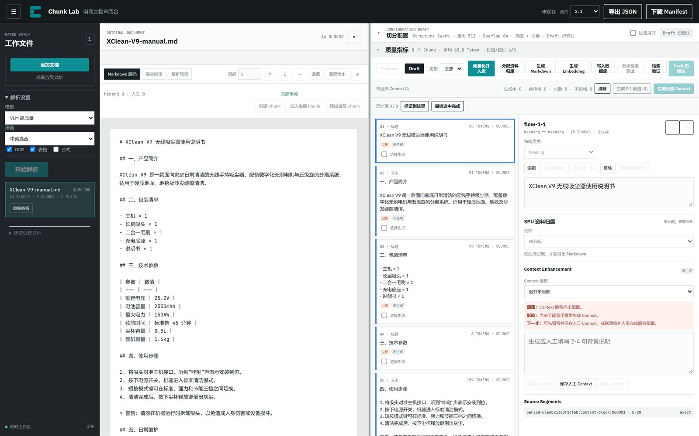

---

## 10. 修订 Draft

### 10.1 编辑文字和类型

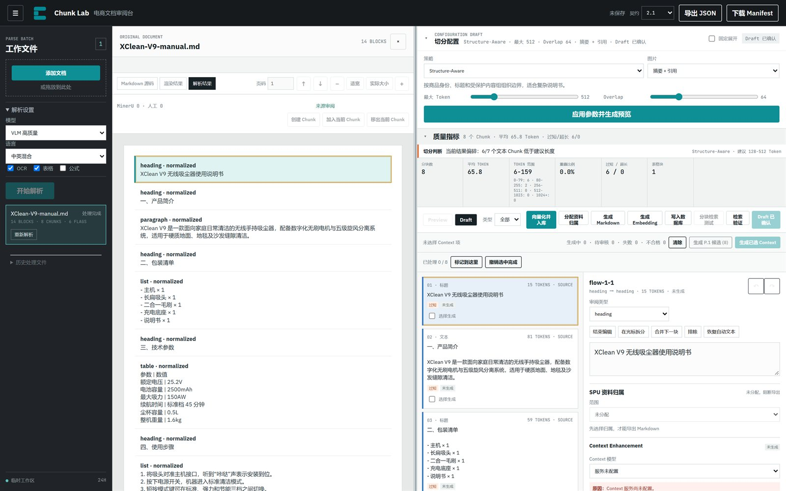

1. 在 Chunk 列表选中一个 Chunk。
2. 点击详情面板的 **编辑**。
3. 修改正文，或在“审阅类型”下拉中改类型。
4. 离开输入框时，系统自动保存并让服务端重算派生状态。
5. 等待顶栏显示“已保存并重算”。

类型可选：标题、文本、列表、表格、图片、公式、代码、警告、图注、脚注、纯文本修复。

修改类型会改变下游处理方式。例如把文本改成表格，会打开表格编辑器；把图片改成文本，会失去图片策略。

### 10.2 拆分

- 先把光标放在正文中间，再点击 **在光标拆分**。
- 仅文本类型可用。
- 只有正文与自动文本一致时才能精确推导来源；人工改写后先点 **恢复自动文本**。
- 拆分后新 Chunk 会获得新 ID，原 Chunk 标记为被替换。

### 10.3 合并

- **合并下一块**：只能合并相邻且类型兼容的 Chunk。
- 不相邻、类型不同、跨文档都不能合并。
- 合并后服务端重算来源范围，来源会保留。

### 10.4 排除与恢复

- **排除**：Chunk 保留在 Draft 和审计轨迹中，但不进入有效 Embedding 下游。
- 选中已排除的 Chunk，按钮变成 **恢复**。
- 排除不是删除；不会删除原文或解析结果。

### 10.5 撤销与重做

详情面板右上角的 `↶` `↷` 作用于当前 Draft 的修订历史，最多保留 40 步。服务端重算完成后才能继续撤销。

### 10.6 Source Segments

详情面板底部列出每个 Chunk 的来源：

- Content Block ID；
- 字符范围（`0-20` 这类）或“Block 级来源”；
- 页码或 `parsed_only`；
- `OVERLAP` 标记。

点击任意来源会跳回原文并高亮。PDF 能定位到 bbox；Markdown/TXT 只能定位到文本 Block。

### 10.7 审阅进度

Draft 工具栏显示“已处理 x / y”：

- **标记到这里**：把当前 Chunk 及之前的所有 Chunk 标记为已处理。
- **撤销选中完成**：取消当前 Chunk 的完成标记。
- 进度保存到服务端，刷新后恢复。

这是协作进度，不是质量门槛；不要求 100% 才能导出，但建议在交付前清零。

---

## 11. 人工框选切分

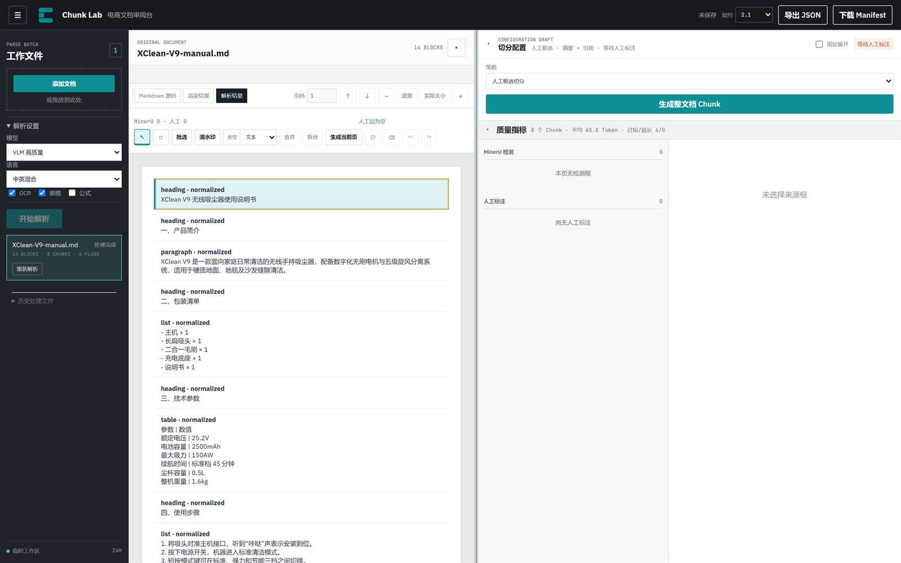

人工框选适合 PDF、图片、Office Visual Copy 这类有页面坐标的文档。Markdown/TXT 没有 bbox，主要依赖文本 Chunk，不建议用人工框选。

### 11.1 工具

| 工具 | 作用 |
| --- | --- |
| 选择 | 点选来源框；`Ctrl/⌘` 多选 |
| 新建文本框 | 在页面上拖出一个新框 |
| 批选 | 框选多个 Block |
| 清水印 | 指定页码范围，批量清理水印 |
| 类型 | 把选中框设为文本、标题、表格、图片、列表、公式、代码、警告、图注 |
| 合并 | 合并同页选中的框 |
| 拆分 | 恢复合并前的框 |
| 生成当前页 | 只按当前页有效框生成部分 Preview |
| 排除 | 切换选中框的排除状态 |
| 删除框 | 删除人工框，不影响原文件 |
| 撤销 / 重做 | 人工标注层的历史 |

### 11.2 生成

- **生成当前页**：适合逐页检查，生成的是部分 Preview。
- **生成整文档 Chunk**：按所有页面的人工标注生成完整 Preview。

部分 Preview 不能直接当作最终结果。正式确认前，应完成所有相关页面并生成整文档。

### 11.3 人工转录

人工框没有可用文字时，详情区会出现 **人工转录文字**。填写后保存到人工修订，页码和坐标仍作为来源，不会写回 Parsed Document。

---

## 12. Context Enhancement

### 12.1 它解决什么问题

有些 Chunk 单独看缺少主语、型号或章节背景。例如一个 Chunk 只写“续航时间为 45 分钟”，检索时不知道是哪款产品。Context 就是附加在 Chunk 外的 2-4 句背景说明，只在 Embedding 时与正文组合，不替代原文。

### 12.2 谁能生成

- 只有 Draft 中的 Chunk 能生成。
- Chunk 必须“可生成”：未被排除、内容合格、有可靠文本；图片还要满足图片策略要求。
- 图片“仅引用”策略自身不生成 Context，应在其关联的文字 Chunk 上生成。
- 服务端必须配置 Context 模型。当前部署未配置模型时，下拉显示“服务未配置”，仍可人工填写。

### 12.3 批量生成

1. 在 Draft 的 Chunk 卡片勾选 **选择生成**。
2. 点击 **生成已选 Context**。
3. 或点击 **生成 P.x 候选（n）**，只处理当前页符合推荐规则的 Chunk。
4. 等待工具栏显示“生成中 / 待审核 / 失败 / 不合格”。

如果选中的 Chunk 已有“已确认”或“人工修改”的 Context，页面会二次确认是否覆盖。不要在不必要的情况下覆盖人工结果。

### 12.4 单块审核


| 状态 | 含义 | 下一步 |
| --- | --- | --- |
| 未生成 | 还没有 Context | 生成，或直接填写人工 Context |
| 生成中 | 请求未结束 | 等待，不要重复提交 |
| 待审核 | 模型结果已返回 | 对照正文检查，确认或修改 |
| 已确认 | 模型结果已人工确认 | 可进入 embeddingText |
| 人工修改 | 人工保存了 Context | 可进入 embeddingText |
| 失败 | 请求失败 | 已保存内容不受影响；重试或人工填写 |
| 已失效 | Chunk 内容/来源变化后旧 Context 过期 | 旧内容只供查看，不进入 embeddingText |

操作：

- **生成 Context**：只生成当前 Chunk。
- **保存人工 Context**：保存人工编写或修改的内容。
- **确认 Context**：确认“待审核”的模型结果。
- **实际采用的 Context 范围**：查看模型用了哪些文档范围。
- **跳过的邻居**：查看哪些相邻 Chunk 因规则被排除。

### 12.5 当前部署提示

实测 `/api/model-profiles` 返回空数组，因此 Context 模型和图片理解模型都显示“服务未配置”。可用的替代路径是：

- 人工填写 Context，保存后状态为“人工修改”，可进入下游；
- 图片使用“仅引用”或“排除”，或在配置了模型后再生成摘要。

---

## 13. 图片与表格

### 13.1 图片策略

| 策略 | 图片自身文本 | 是否发 VLM | 必须关联文字 |
| --- | --- | --- | --- |
| 摘要 + 引用 | 人工审核后的摘要 | 可选 | 否 |
| 仅引用 | 空 | 否 | 是，至少一个有效文字 Chunk |
| 排除 | 空 | 否 | 否 |

### 13.2 摘要 + 引用

1. 选中图片 Chunk，点击“编辑”。
2. 图片策略选“摘要 + 引用”。
3. 从“图片理解模型”下拉选择管理员配置的 profile。
4. 点击 **发送图片并生成摘要**。这可能产生模型费用，只点一次。
5. 阅读只读的“VLM 原始摘要”，对照原图检查商品、型号、数值、单位、颜色和图中文字。
6. 在“人工摘要”中改写错误或不完整内容；在“人工补充”中补充检索信息。
7. 检查“最终生效文本”。
8. 点击 **保存图片策略**，等待保存完成。

VLM 失败不会覆盖已保存摘要。没有配置模型时，不能生成，但可以手写摘要或改用其他策略。

### 13.3 仅引用

- 图片自身不进入文本 Embedding。
- 必须关联至少一个同文档、未排除、可检索的文字 Chunk。
- 关联文字不会自动拼进图片摘要；下游通过关联文字工作。
- 文字 Chunk 被排除/替换后，服务端会重算图片资格，详情会提示失效关联。

### 13.4 表格

把 Chunk 类型设为 `table` 后，详情面板变成表格编辑器：

- 编辑表格标题、列标题、单元格文字。
- 上方/下方加行，左侧/右侧加列，删除选中列，删除指定行。
- 勾选单元格后“合并选中”或“拆分单元格”。
- 按来源行组显示“行组 n”，重复表头会标注。
- 点击 **保存表格**，等待服务端重算。

限制：

- 合并必须是连续矩形，不能跨来源行组。
- 包含跨行合并时，部分增删会被阻止，先拆分。
- 每个来源行组至少保留一行。
- 表格至少保留一行。

表格下方还有 **普通检索关联文字**：

1. 搜索并勾选同一文档中的有效文字 Chunk。
2. 点击 **保存表格检索版本**。
3. 成功后显示版本号和“已保存并就绪/未就绪”。

表格检索只引用关联文字，不需要人工摘要或 VLM。未关联文字时不能保存。

---

## 14. SPU 商品资料归属

### 14.1 为什么需要

Chunk Lab 不只输出一份文档，还要把资料组织到商品（SPU）上。确认资料归属后，才能按 SPU 生成 Markdown，并支持一份文档分发到多个 SPU。

### 14.2 打开对话框

在 Draft 模式点击 **分配资料归属**，打开“SPU 商品资料”对话框。

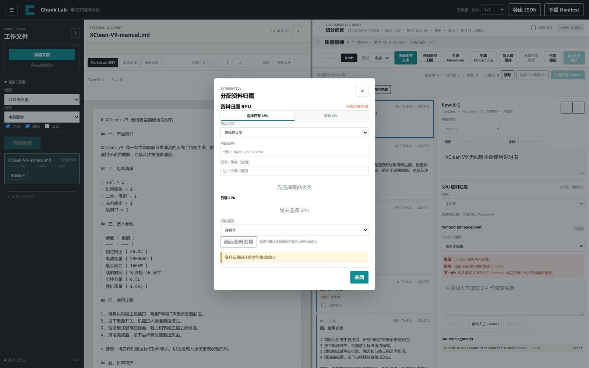

当前部署 `/api/spu-categories` 返回空，说明商品大类还没有建。第一次使用要先新增类目。

### 14.3 新建类目与 SPU

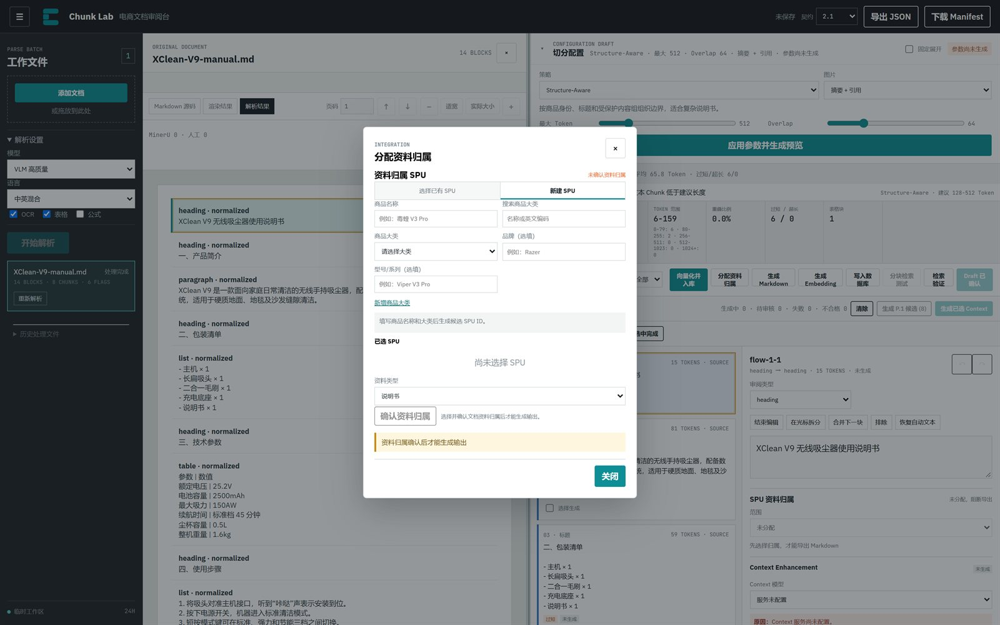

1. 切到 **新建 SPU**。
2. 填写商品名称，例如“毒蝰 V3 Pro”。
3. 在“搜索商品大类”输入名称或英文编码；如果没有匹配，点击 **新增商品大类**。
4. 填写类目名称和英文编码（最多 8 位），点击 **保存类目**。
5. 回到新建 SPU，选择类目，按需填写品牌、型号/系列。
6. 系统生成候选 SPU ID，并检查疑似重复。
7. 没有重复时点“创建并使用”；有疑似重复时先核对，再决定“使用此 SPU”或“仍然创建新 SPU”。
8. 创建后 SPU 加入“已选 SPU”列表。

### 14.4 选择已有 SPU

1. 切到 **选择已有 SPU**。
2. 先选商品大类。
3. 输入商品名称或型号，列表会缩小范围。
4. 点击“加入已选”。

### 14.5 资料类型

| 选项 | 适用 |
| --- | --- |
| 说明书 | 使用说明、操作指南 |
| 参数表 | 规格、技术参数 |
| 安装指南 | 安装、部署、组装 |
| 售后政策 | 保修、退换、维修 |
| 混合资料 | 多种类型混在一份文档 |
| 其他 | 不属于以上类型 |

### 14.6 确认归属

选择至少一个 SPU 和资料类型后，点击 **确认资料归属**。确认前：

- 普通 Chunk 会继承文档级 SPU；
- 确认后可以逐个设置 Chunk 例外；
- 未确认时，“生成 Markdown”不可用。

### 14.7 Chunk 级归属

详情面板的“SPU 资料归属”支持四种范围：

| 范围 | 含义 | 导出行为 |
| --- | --- | --- |
| 指定 SPU | 只属于勾选的目标 SPU | 只进入这些 SPU 的 Markdown |
| 公共资料 | 复制到所有目标 SPU | 每个目标 SPU 都包含 |
| 未分配 | 没有归属 | 阻断导出 |
| 冲突 | 归属互相矛盾 | 阻断导出 |

存在未分配或冲突时，整个 SPU Markdown 导出会被阻断。先逐块处理，再生成。

### 14.8 生成 Markdown 与 Manifest

确认归属后，点击 **生成 Markdown**。结果区会按 SPU 列出：

- SPU ID；
- 状态：尚未生成、待生成、已生成、已生成含排除项、已阻断、需重新生成、失败；
- 文件名和导出版本；
- Markdown / Manifest 下载链接；
- 阻断原因或过期原因。

文件命名规则：

```
{spuId}_{documentType}_{来源文件名}_{exportVersion}.md
```

Markdown 结构：

- 顶部元数据：SPU、文档类型、来源文档、来源版本、Review Revision、导出版本；
- 按 Chunk 顺序输出；
- 表格输出为 Markdown 表格；
- 图片输出为 Markdown 图片引用；
- 重叠内容去重。

多 SPU 时，每个 SPU 生成一个 child；任一 child 被阻断，整体状态为 `blocked`。文档或审阅版本变化后，旧导出会变成 `stale`，需要重新生成。

---

## 15. Embedding、数据库与检索

### 15.1 当前可用的模型和数据库

实测配置：

| 类型 | 当前值 |
| --- | --- |
| Embedding | `文本向量 1024`，1024 维，最大 8192 Token |
| 数据库 | `测试知识库`，pgvector，schema 2.0 |
| Context/VLM | 未配置（模型列表为空） |

### 15.2 生成 Embedding

1. 进入 Draft。
2. 点击 **生成 Embedding**，或直接使用 **向量化并入库**。
3. 选择模型。
4. 等待任务完成。

每个 Chunk 的状态：

| 状态 | 含义 |
| --- | --- |
| 成功 | 已生成向量记录 |
| 失败 | 请求或校验失败，可重试 |
| 跳过 | 被排除、不合格、仅引用图片或无有效文本 |

任务级信息：成功、失败、跳过数量；是否幂等复用；是否已失效。修改 Draft 后，旧 Embedding 会标记为失效，需要重新生成。

“重试失败项”只重试失败项，不会重做成功项。

### 15.3 写入数据库

1. 先完成 Embedding。
2. 点击 **写入数据库**。
3. 选择目标数据库。
4. 提交。

每个 Chunk 的状态：

| 状态 | 含义 |
| --- | --- |
| 已写入 | 新写入或更新 |
| 未变化 | 数据库已有相同版本，未重复写 |
| 已删除 | 该 Chunk 在新版本中被排除或删除，数据库记录被清理 |
| 失败 | 写入失败，可重试 |
| 跳过 | 没有可写入的向量记录 |

数据库写入依赖 Embedding 任务。没有成功向量时，不要直接点写入。

### 15.4 向量化并入库（快速入库）

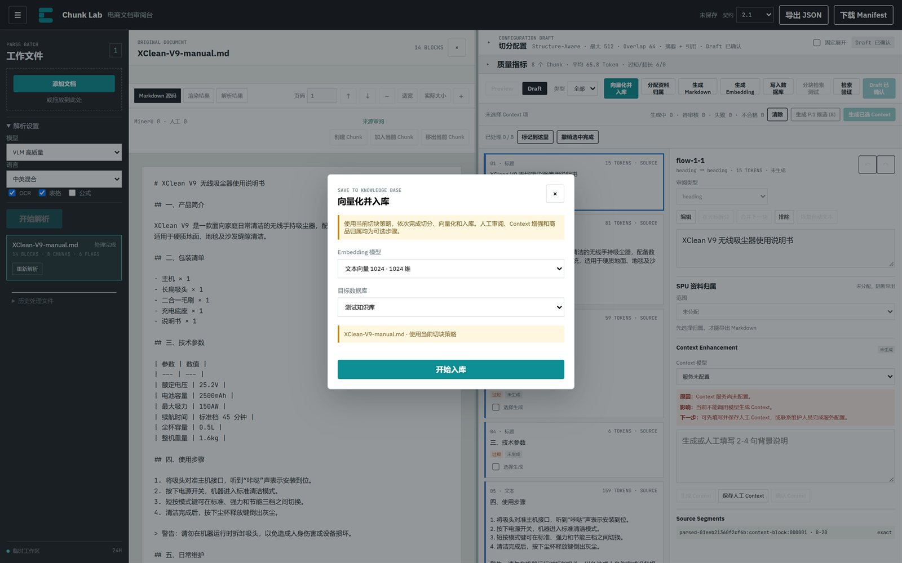

这是最短路径，适合试跑和结构简单的文档：

1. 解析完成后点击 **向量化并入库**。
2. 选择 Embedding 模型和目标数据库。
3. 点击 **开始入库**。

内部依次执行：

1. 如果配置有改动或还没有 Preview/Draft，先切分；
2. 如果有 Preview，采用为 Draft（已有 Draft 时可能提示替换）；
3. 向量化；
4. 写入数据库。

注意：

- 它不会替你审核内容，也不会生成 Context、图片摘要或 SPU 归属。
- 如果已有 Draft，替换会清除人工修订和 Context，页面会二次确认。
- 入库后仍可回到 Draft 继续审阅，但修改后要重新向量化和写入。

### 15.5 分块检索测试

前提：已经完成数据库写入。

1. 点击 **分块检索测试**。
2. 输入测试查询。
3. 设置 Top K（默认 5）。
4. 填写人工确认相关的 Chunk ID，每行一个或用逗号分隔。
5. 点击 **运行 Recall@K**。

结果包括：

- `Recall@K` 百分比；
- 命中数 / 相关数；
- 索引版本；
- 使用的 Embedding 模型、数据库、已入库记录数 / Draft Chunk 数；
- 每个结果的分数、文本、是否命中；父子分块时还能展开父块。

这是单文档、小样本的检索自检，不是全库评测。它回答“这次入库的 Chunk 能不能被查回来”，不回答“整个知识库的检索质量”。

### 15.6 检索验证

Draft 中还有 **检索验证**，点击会在新标签页打开“智能检索”应用（当前配置为 `http://203.0.113.10:18185/`）。它用于在消费端验证问答效果，具体操作见该应用自己的界面。

---

## 16. 导出与交付

### 16.1 导出 JSON

1. 顶栏“契约”选 `2.1`（默认）或 `Legacy`。
2. 点击 **导出 JSON**。
3. 检查文件名：`chunk-lab-2.1-export.json`。

`2.1` 会保留来源、配置、人工修订、质量标记、图片关联和模型 provenance。`Legacy` 只用于下游明确要求旧格式的场景；缺少 Contract 2.1 规范模型的文档可能导出失败。

### 16.2 下载 Manifest

点击 **下载 Manifest**，得到批次级清单：文档 ID、状态、Chunk 数、导出时间、契约版本。它不含完整正文，适合交付核对和归档索引。

### 16.3 SPU Markdown 与 Manifest

在“分配资料归属”对话框中生成。每个 SPU 一份 Markdown，一份 Manifest。下载链接只在生成成功后出现。

### 16.4 导出前的检查

- 顶部保存状态不是“未保存”。
- Draft 中要交付的 Chunk 没有意外“排除”。
- 表格、图片、Context 的修改已保存。
- SPU 归属没有“未分配/冲突”（按 SPU 交付时）。
- Embedding/数据库任务是最新版本（需要下游检索时）。
- 导出文件里没有密钥、连接串、预签名 URL 或向量值。

---

## 17. 协作、保存与只读

### 17.1 文档租约

同一份文档同一时间只允许一个会话编辑。打开文档时，前端会申请一个 60 秒租约，并定时续租。

如果另一个会话正在处理：

- 当前页面显示“文档正在由其他会话处理，当前为只读状态”；
- 可以查看原文、解析结果和已保存内容；
- 编辑、生成、入库等按钮不可用；
- 占用结束后页面会自动恢复编辑，不需要刷新。

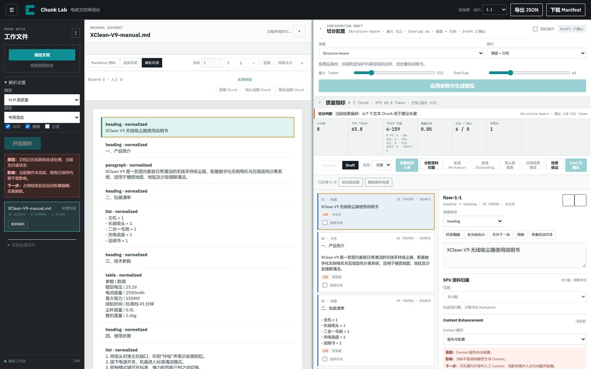

不要用多个标签页同时编辑同一文档。需要并行处理时，选择不同文档。

### 17.2 保存状态

| 显示 | 含义 |
| --- | --- |
| 未保存 | 页面刚打开或还有操作未提交 |
| 已保存并重算 | Chunk 修改已保存，服务端完成派生重算 |
| 人工 Context 已保存 | Context 已写入 Draft |
| 已保存并重算 / 已更新 | 标注或配置已保存 |
| 保存失败 | 请求失败，先处理错误再继续 |

### 17.3 错误框

错误按三段显示：

- **原因**：为什么没完成；
- **影响**：哪些结果没生成，哪些已保存内容仍然安全；
- **下一步**：你可以执行的恢复动作。

优先按“下一步”处理。不要因为页面没更新就连续点击。

---

## 18. 当前部署实测

以下结果来自 2026-11-10 对 `http://203.0.113.10:18184/` 的实际访问，仅代表当前测试环境。

| 检查项 | 结果 |
| --- | --- |
| 登录 | 成功进入 XShipAI 工作台 |
| 应用数量 | 6 个 |
| Chunk Lab 健康检查 | `{"ok":true}` |
| Chunk Lab 版本 | v0.1.47 |
| Context/VLM 模型 | 空列表，界面显示“服务未配置” |
| Embedding 模型 | 1 个：文本向量 1024，1024 维，8192 Token |
| 数据库 | 1 个：测试知识库，pgvector，schema 2.0 |
| SPU 商品大类 | 空列表，需要先新增 |
| 智能检索地址 | `http://203.0.113.10:18185/` |

### 18.1 演示文档结果

用一份 1.3 KB 的 Markdown 说明书 `XClean-V9-manual.md` 做了只读验证：

| 指标 | 结果 |
| --- | --- |
| 解析 | 本地解析完成，14 个 Block |
| 切分策略 | Structure-Aware，512 / 64 |
| Chunk 数 | 8 |
| 平均 Token | 65.8 |
| Token 范围 | 6-159 |
| 过短 / 超长 | 6 / 0 |
| 表格块 | 1 |
| 类型 | 标题、文本、列表、表格 |

结果解读：这份文档章节短、列表多，8 个 Chunk 里有 6 个文本块低于 Structure-Aware 的建议下限（128 Token）。这不是解析错误，而是“短章节文档”的正常表现。若用于检索，可考虑：

- 把最大 Token 调到 768-1024，让相邻短章节合并；
- 或改用父子分块，子块 384、父块 1536，检索命中后回填父块；
- 或在人工框选模式下合并过短章节。

本次验证没有执行 Embedding、数据库写入和 SPU Markdown 生成，避免向共享测试库写入演示数据。因此这三个入口的界面可见，但结果状态未在本手册中作为实测结论。

### 18.2 功能可用性

| 功能 | 当前状态 | 说明 |
| --- | --- | --- |
| 上传与解析 | 可用 | Markdown/TXT 本地解析；PDF/Office/图片走 MinerU |
| 六种切分策略 | 可用 | 人工框选需要页面 bbox |
| Preview / Draft / 修订 | 可用 | 已实测生成 8 个 Chunk 并进入 Draft |
| Context 生成 | 不可用（未配置模型） | 可人工填写 Context |
| 图片摘要 | 不可用（未配置模型） | 可用“仅引用”或“排除” |
| 表格编辑与检索版本 | 可用 | 依赖表格 Chunk 和有效文字 Chunk |
| SPU 归属与 Markdown | 需先建类目 | 当前商品大类为空 |
| Embedding | 已配置 | 未执行写入验证 |
| 数据库写入 | 已配置 | 未执行写入验证 |
| 检索测试 | 需先入库 | 未执行 |
| JSON / Manifest 导出 | 可用 | Draft 存在时启用 |

---

## 19. 故障排查

| 现象 | 可能原因 | 处理 |
| --- | --- | --- |
| 上传后立即失败 | 格式不支持、文件损坏、加密、对象存储未配置 | 换格式或解密；下载诊断包；联系管理员 |
| 解析结果为空或乱码 | 扫描件未开 OCR、语言选错、文件是图片型 PDF | 打开 OCR，确认语言；重新解析 |
| “开始解析”按钮灰色 | 没有待上传文件 | 先添加文件 |
| “应用参数并生成预览”灰色 | 没有选中已完成文档，或文档只读 | 选中“处理完成”的文档；等待租约恢复 |
| 改了参数但预览没变 | 只改了配置草稿，没有重新生成 | 点“应用参数并生成预览” |
| “采用此 Preview”变成“请先生成新 Preview” | 配置指纹变了，旧 Preview 过期 | 重新生成 Preview |
| 采用 Preview 时要求确认替换 | 已有 Draft，替换会清除修订/Context | 先导出或确认影响，再决定 |
| Context 生成按钮灰色 | 非 Draft、Chunk 不可生成、未选模型、已排除 | 看详情面板的“原因/影响/下一步” |
| 图片摘要按钮灰色 | 策略不是“摘要 + 引用”，或没有 VLM 模型 | 改策略；没有模型时手写摘要或用“仅引用” |
| “仅引用”保存失败 | 没有关联有效文字 Chunk | 搜索并勾选至少一个文字 Chunk |
| SPU Markdown 按钮灰色 | 未确认资料归属、存在未分配/冲突 Chunk | 先确认归属，再逐块处理例外 |
| SPU 导出显示“已阻断” | 有 Chunk 未分配或冲突 | 看阻断原因，修正 Chunk 归属 |
| SPU 导出显示“需重新生成” | 文档或审阅版本变化，旧导出过期 | 重新生成 Markdown |
| Embedding 部分失败 | 模型超时、文本不合格、维度不匹配 | 看失败原因，只重试失败项 |
| 数据库写入失败 | 没先做 Embedding、连接失败、维度不匹配 | 先完成 Embedding；检查数据库 profile |
| 检索测试按钮灰色 | 还没有数据库任务 | 先完成“写入数据库” |
| 页面提示只读/其他会话处理 | 另一个标签页或用户持有 60 秒租约 | 关闭其他会话，等待自动恢复 |
| 刷新后历史文件不见了 | 清除了站点数据或换了浏览器 | 从原批次入口重新打开；服务端数据可能仍在 24 小时内 |
| 导出为空或失败 | 没有 Draft，或 Legacy 缺少 2.1 模型 | 先采用 Preview；换 2.1 契约 |

---

## 20. 最佳实践与验收清单

### 20.1 参数起步建议

| 文档类型 | 策略 | 参数 |
| --- | --- | --- |
| 商品说明书（章节清晰） | Structure-Aware | 512 / 64 |
| 长说明书、问答检索 | 父子分块 | 父 1536 / 子 384 / 重叠 64 |
| 连续段落、政策文本 | SentenceSplitter | 512 / 64 |
| Token 预算严格 | TokenTextSplitter | 512 / 64 |
| 主题切换明显 | Semantic Boundary | Buffer 1 / 90% / 768 |
| 版面复杂、自动检测差 | 人工框选 | 逐页修订 |

### 20.2 审阅顺序

1. 先看解析：标题、表格、图片、阅读顺序。
2. 再看切分：质量指标 + 抽查 Chunk。
3. 再改内容：文字、类型、拆分/合并/排除。
4. 再做增强：图片摘要、Context、表格关联。
5. 再做归属：SPU 文档级 + Chunk 级。
6. 最后做下游：Embedding → 数据库 → 检索测试 → 导出。

不要跳过第 1、2 步直接入库。快速入库适合试跑，不适合正式交付。

### 20.3 交付前清单

- [ ] 文件状态为“处理完成”，没有解析失败。
- [ ] 每个 Chunk 的类型正确，表格/图片没有被误判为文本。
- [ ] 过短/超长块已评估，必要时调参或合并。
- [ ] Source Segments 能回到正确页码/Block。
- [ ] 人工修订已保存，顶栏不是“未保存”。
- [ ] 图片策略符合下游需求；仅引用都有文字关联。
- [ ] Context 已确认或人工修改，过期 Context 已处理。
- [ ] 表格检索版本已保存（如使用表格检索）。
- [ ] SPU 归属已确认，没有未分配/冲突。
- [ ] Embedding 没有失败项，数据库写入完成。
- [ ] Recall@K 自检通过（如需要）。
- [ ] 导出的 JSON/Markdown 不含密钥、连接串、预签名 URL 或向量值。

---

## 附录 A：按钮速查

| 按钮/控件 | 位置 | 作用 |
| --- | --- | --- |
| 添加文档 | 左栏 | 选择或拖入文件 |
| 开始解析 | 左栏 | 提交当前批次 |
| 重新解析 / 重试 | 文件行 | 重跑单份文档，可能清除旧结果 |
| 下载诊断包 | 文件行 | 下载脱敏诊断 JSON |
| 应用参数并生成预览 | 切分配置 | 按当前参数生成 Preview |
| 生成整文档 Chunk | 人工模式 | 按人工标注生成完整 Preview |
| 生成当前页 | 人工模式 | 生成部分 Preview |
| 采用此 Preview | 模式栏 | Preview → Draft |
| 放弃 Preview | 模式栏 | 丢弃 Preview，保留 Draft |
| 编辑 / 结束编辑 | 详情 | 进入/退出 Chunk 编辑 |
| 在光标拆分 | 详情 | 文本 Chunk 按光标拆分 |
| 合并下一块 | 详情 | 合并相邻同类型 Chunk |
| 排除 / 恢复 | 详情 | 切换下游资格 |
| 恢复自动文本 | 详情 | 丢弃人工正文修改 |
| 保存表格 | 表格编辑器 | 保存结构化表格 |
| 保存表格检索版本 | 表格详情 | 保存表格与文字 Chunk 的检索关系 |
| 发送图片并生成摘要 | 图片详情 | 调用 VLM，可能产生费用 |
| 保存图片策略 | 图片详情 | 保存策略、摘要和关联 |
| 生成 Context | 详情 | 单块生成 |
| 保存人工 Context | 详情 | 保存人工背景说明 |
| 确认 Context | 详情 | 确认待审核结果 |
| 生成已选 Context | Context 工具条 | 批量生成 |
| 生成 P.x 候选 | Context 工具条 | 生成当前页推荐项 |
| 标记到这里 | 审阅进度 | 批量标记完成 |
| 分配资料归属 | 模式栏 | 打开 SPU 对话框 |
| 确认资料归属 | SPU 对话框 | 固定文档级 SPU |
| 生成 Markdown | 模式栏/SPU 对话框 | 按 SPU 生成 Markdown |
| 生成 Embedding | 模式栏 | 启动向量化任务 |
| 写入数据库 | 模式栏 | 写入 pgvector |
| 向量化并入库 | 模式栏 | 切分→向量化→入库 |
| 分块检索测试 | 模式栏 | 运行 Recall@K |
| 检索验证 | 模式栏 | 打开智能检索应用 |
| 导出 JSON | 顶栏 | 导出当前批次 |
| 下载 Manifest | 顶栏 | 下载批次清单 |

## 附录 B：状态字典

**文件状态**：待解析、上传中、排队、解析中、处理完成、已复用、失败。

**Context 状态**：未生成、生成中、待审核、已确认、人工修改、失败、已失效。

**Embedding 状态**：成功、失败、跳过；任务状态包括完成、部分失败、失败、已失效。

**数据库状态**：已写入、未变化、已删除、失败、跳过。

**SPU 导出状态**：尚未生成 Markdown、待生成、已生成、已生成含排除项、已阻断、需重新生成、失败。

**SPU 范围**：指定 SPU、公共资料、未分配、冲突。

---

*本手册基于当前部署的实际界面和接口整理。平台升级后，按钮名称、默认参数或模型配置可能变化，以页面实际显示为准。*
