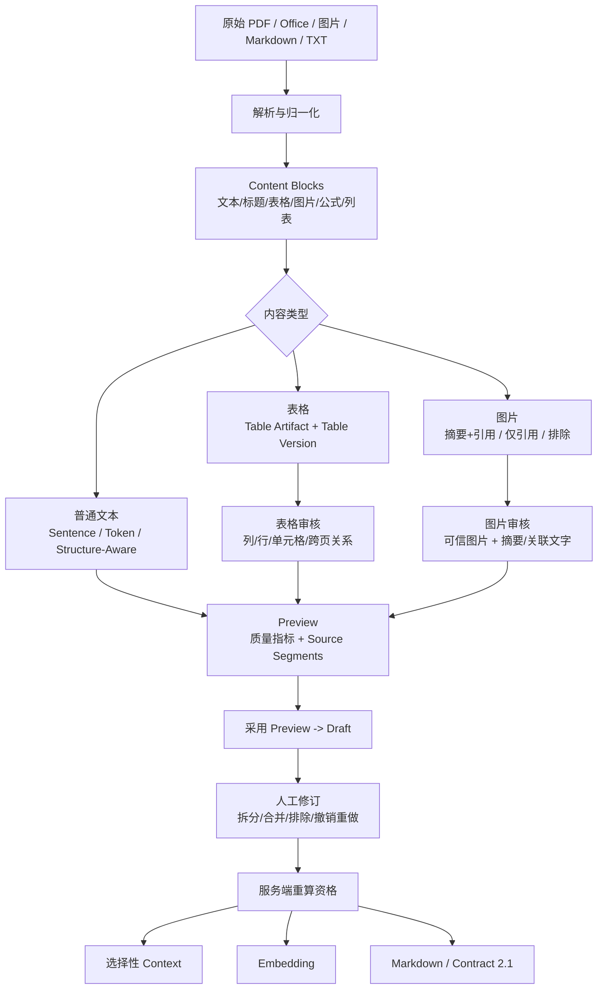
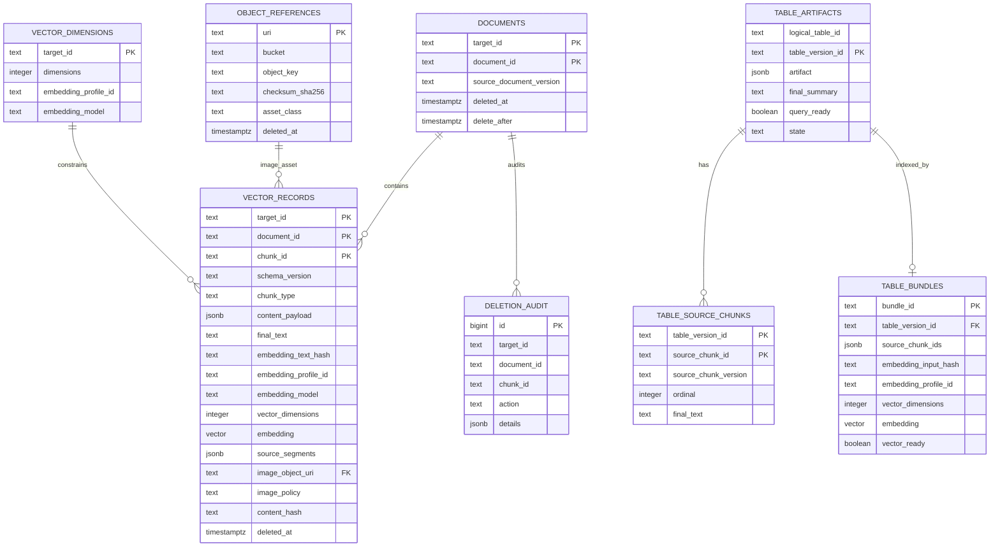

# Chunk Lab 复杂内容处理与存储设计

这份文档用于项目展示和面试讲解，回答四个问题：

1. 跨页表格、长表格、图片等复杂内容如何切割和审核？
2. 哪些内容会发送给 LLM 做 Context 增强？
3. 图片的三种策略分别是什么？
4. 业务状态、原始文件、表格结构和向量如何存储？

## 1. 总体原则

系统不把“解析结果”直接当成“可检索知识”。完整链路是：

```text
原始文件
  -> MinerU / 本地解析
  -> Parsed Document / Content Blocks
  -> Preview（可重新生成的提案）
  -> Draft（人工确认后的工作版本）
  -> Context / Embedding / Markdown / pgvector
```

核心不变量：

- 原始文件和原始解析结果不可被人工编辑覆盖。
- 每个 Chunk 保留 `Source Segments`，包括文档、页码、bbox、来源 Block、文本范围等证据。
- Preview 和 Draft 分离。调参只会产生新 Preview，必须显式采用后才能影响 Draft。
- 只有经过审核且满足资格的 Chunk 才能进入 Context、Embedding 或数据库写入。
- Markdown 导出和向量化从同一个 reviewed Chunk 快照分叉，但互不以对方产物作为输入。
- Context 是附加背景，不替代 Chunk 原文；正文变化会使已确认 Context 变为 `stale`。

## 2. 复杂内容切割流程



### 2.1 普通文本

- `SentenceSplitter`：适合连续自然语言，优先保持句子完整。
- `TokenTextSplitter`：需要稳定 Token 尺寸时使用，但语义边界保护较弱。
- `Structure-Aware`：优先保持标题、正文、图注、表格说明等结构关系，通常是产品文档的默认候选。
- `Semantic Boundary`：使用 Embedding 计算句段语义距离，在主题切换处建议断开；需要可用的 Embedding profile。
- `人工框选切分`：版面复杂或自动检测不可靠时，基于 MinerU 检测框进行人工修订，再按页或整文档生成 Chunk。

参数修改不会自动覆盖现有 Draft，必须点击“应用参数并生成预览”。质量指标是审核线索，不是自动通过分数。

## 3. 表格：跨页、长表格和结构化保存

### 3.1 为什么不能把表格当普通长文本

表格中的列关系、行关系、合并单元格、单位和表头重复信息都属于事实结构。直接把整张表拼成长文本再做向量化，会产生三个问题：

1. 大表重复占用 Embedding 成本和向量空间。
2. 表格改版后，旧向量容易与新结构混淆。
3. 检索命中后无法可靠地回答“哪一行、哪一列、哪个单元格”。

因此采用三层模型：

```text
Table Artifact（权威结构）
  -> Table Version（不可变审核版本）
  -> Table Retrieval Bundle（普通语义检索代理文本 + 一条向量）
```

### 3.2 跨页表格

跨页表格首先要解决“是不是同一张表”，而不是先切 Token：

1. 保留每页的 `page_idx/bbox` 和原始来源 Block。
2. 审核人员确认跨页表头、列顺序、行连续性和单位是否一致。
3. 将跨页部分归入同一个 `logical_table_id`，形成一个新的 `table_version_id`。
4. `artifact` 中保存列、行、单元格、合并关系和行组；来源 Chunk 通过 `table_version_source_chunks` 按顺序关联。
5. 如果跨页关系无法确认，不强行合并；保留为多个逻辑表或交给人工框选。

这样做的关键是：**跨页关系由结构和人工审核确认，不能靠普通文本切块器猜测。**

### 3.3 长表格

长表格不生成“每一行一条普通向量”的重复结果，也不把 HTML/raw table 当 Embedding 输入。当前设计是：

- 完整结构保存到 `table_artifacts.artifact`，支持列、行、单元格、行组和合并单元格。
- 通过 `table_version_source_chunks` 保存该版本对应的审核 Chunk、版本和顺序。
- 使用最终审核摘要、必要身份信息和有序关联文字生成一个 `Table Retrieval Bundle`。
- Bundle 只负责“发现这张表”；命中后根据 `table_version_id` lazy-load 完整 Artifact。
- 按行、列、范围、单位进行精确查询属于未来 Deep Retrieval 边界，不冒充成当前普通向量检索能力。

### 3.4 表格人工编辑约束

表格进入 Draft 后可编辑标题、列标题、单元格、行列和合并单元格。合并单元格必须是连续的完整矩形，且不能跨来源行组；遇到跨行单元格时，先拆分再继续。保存后由服务端重新计算内容哈希、资格和下游状态。

## 4. 图片处理：三种策略

图片本身不是“随便发给视觉模型的一张图”。首先要确认图片来源可信：原始图片，或服务端按精确页码和 bbox 从版本匹配的 PDF 裁剪；浏览器自报 URL、占位图和临时签名 URL 都不能作为模型输入。

| 策略 | 是否调用 VLM | 图片自身是否进入文本 Embedding | 必要条件 |
| --- | --- | --- | --- |
| `摘要 + 引用` | 可调用 | 可以，使用人工确认后的图片摘要 | 可信图片；摘要需人工审核，可选关联同文档文字 Chunk |
| `仅引用` | 不调用 | 不进入 | 至少关联一个同文档、未排除且有资格的文字 Chunk |
| `排除` | 不调用 | 不进入 | 图片保留在 Draft/审计中，但不进入有效下游 |

### 4.1 摘要 + 引用

VLM 只生成候选摘要，不拥有最终事实。审核流程是：

1. 选择可信图片和图片理解模型。
2. 发送图片生成只读的 VLM 原始摘要。
3. 对照图片检查商品、型号、数值、单位、颜色、适用范围和图中文字。
4. 在人工摘要/人工补充中修订，并保存最终生效文本。
5. 可选关联同文档文字 Chunk；关联关系独立保存，不自动拼进图片 `finalText`。

VLM 失败不会覆盖已有人工摘要。图片摘要或策略变化会触发服务端重算资格，已确认 Context 可能变为 `stale`。

### 4.2 仅引用

适用于图片只是正文、图注或说明的视觉载体。图片自身没有 `finalText`、Context 或文本 Embedding，检索通过关联的文字 Chunk 完成。关联对象必须是同一文档内有效文字 Chunk，不能关联图片、表格、自身或已失效对象。

### 4.3 排除

图片仍保留原始证据和审核轨迹，但被排除在有效 Embedding 和 Context 下游之外。它不是物理删除，后续可以恢复并重新审核。

## 5. Context 增强：哪些内容发送给 LLM

Context 不是对所有 Chunk 自动调用 LLM。规则先产生候选，人员再选择，服务端最后做资格校验。

### 5.1 发送条件

通常只有以下内容会被选中发送：

- 已进入 Draft、未排除且内容已确认的 Chunk。
- 具有有效 `finalText`，且不是失效或不完整状态。
- 需要补充产品名、型号、章节、适用范围等背景的 Chunk。
- 对 `摘要 + 引用` 图片，通常先完成可信图片摘要；`仅引用` 图片本身不发送 Context。
- 同文档邻居只作为受控上下文范围，系统记录实际使用范围和被跳过邻居原因。

不会发送的内容包括：未审核 Preview、被排除 Chunk、无有效最终文本的 Chunk、失效 Context 作为新依据、无法确认来源的图片，以及不属于当前文档的关联对象。

### 5.2 LLM 输入与输出边界

LLM 输入应是服务端组装的受控文本范围，不接受前端自行提交 token、资格字段或最终派生状态。LLM 输出是 `awaiting_review` 候选，不能直接覆盖人工正文。

Context 状态：

```text
not_generated -> generating -> awaiting_review -> confirmed
                                      |                  |
                                      v                  v
                                    failed          human_modified

正文、来源、图片摘要等变化 -> stale
```

只有 `confirmed` 或 `human_modified` 的 Context，才会与 `finalText` 组合为 `embeddingText`。`stale` Context 仍可供审阅，但不能进入新的 Embedding。

## 6. 数据库存储设计

### 6.1 三种存储职责

| 存储 | 保存内容 | 不保存内容 |
| --- | --- | --- |
| PostgreSQL | 状态、版本、哈希、结构化元数据、审核记录、资格、向量元数据 | 原始二进制、过期签名 URL、凭证、Base64 |
| MinIO / Object Storage | 原始文件、MinerU ZIP、可信结果、Parsed Document 快照、图片和导出文件 | 业务关系和检索索引 |
| PostgreSQL + pgvector | 普通 Chunk 向量、表格 Bundle 向量及其检索元数据 | 生产凭证、公开向量值、未审核内容 |

### 6.2 核心关系



### 6.3 普通 Chunk 向量表

实际表名按维度区分，例如 `rag.vector_records_v2_d1024`。主键是：

```text
(target_id, document_id, chunk_id)
```

重要字段：

- `final_text`：审核后的最终文本。
- `embedding_text_hash`：实际送入 Embedding 的文本哈希，用于幂等和版本判断。
- `embedding_profile_id / embedding_model / vector_dimensions`：模型和维度契约。
- `source_segments`：检索命中后回溯页码、bbox 和来源 Block 的依据。
- `image_object_uri`：只引用对象元数据，不保存图片二进制。
- `deleted_at / delete_after`：软删除优先，延迟物理清理。

向量表使用 HNSW cosine index，并在 SQL 中显式过滤 `deleted_at IS NULL`。同一个 `target_id` 不允许混用不同维度；当前本地 production-like 验收观察到的是 1024 维。

### 6.4 表格存储

- `rag.table_artifacts`：保存列、行、单元格、合并关系等权威 JSONB 结构。
- `rag.table_version_source_chunks`：保存表格版本与来源 Chunk 的顺序、版本和最终文本快照。
- `rag.table_retrieval_bundles_v1_d1024`：保存一张表版本的检索代理文本和一条向量。
- `logical_table_id` 表示同一张逻辑表，`table_version_id` 表示一次不可变审核版本。
- 新版本先写入并完成向量，成功后再让旧版本退出 active；失败时旧 active 版本继续可检索。

### 6.5 幂等、版本和删除

- 解析缓存由 `(content_sha256, parser_config_fingerprint)` 唯一确定，避免相同文件和配置重复提交 MinerU。
- Embedding 使用文本哈希、profile、模型、维度和 Chunk 版本判断是否可复用。
- 数据库写入使用目标、文档、Chunk 和版本信息做幂等 upsert；重复提交不会产生重复向量。
- 删除先写 `deleted_at` 并记录 `deletion_audit`，到达 `delete_after` 后才允许物理 GC。
- 原始对象和派生对象以稳定 object key、checksum 和 asset class 管理；公开接口不返回签名 URL、凭证或向量本体。

## 7. 面试 STAR 讲法

**Situation**：复杂电商资料里有跨页表格、图片和长文本，直接把解析结果切成向量会丢失结构和来源。

**Task**：建立一条可审核、可追溯、可版本化的知识生产链路。

**Action**：我把表格拆成 Artifact、Version、Retrieval Bundle；把图片拆成三种策略；Context 只对选中的合格 Chunk 调用 LLM，并让人工确认决定是否进入 `embeddingText`；PostgreSQL 保存状态和关系，MinIO 保存大对象，pgvector 只保存带版本和来源元数据的向量。

**Result**：真实 PDF 本地验收覆盖 23 页、257 个 source blocks、55 个 Draft Chunks；Embedding 38 个成功、17 个跳过；Recall@5 对人工确认相关 Chunk 命中 1/1，并验证了刷新/重启恢复。这个结果是窄范围验收，不代表通用检索效果；线上生产部署也不在当前完成声明内。

## 8. 代码与文档索引

- 解析和切分：`src/mineru.ts`、`src/chunking.ts`、`src/manual-annotations.js`
- Context 生命周期：`src/contextual.ts`、`src/context-review.ts`
- Embedding 与入库：`src/embedding-job.ts`、`src/database-job.ts`
- 表格设计：`docs/issue14-table-processing-strategy-and-interview-guide.md`
- 数据库表结构：`docs/rag-database-schema-reference.md`
- 用户操作流程：`docs/document-review-workbench-user-manual.md`
- 当前验收边界：`PROJECT_STATUS.md`

