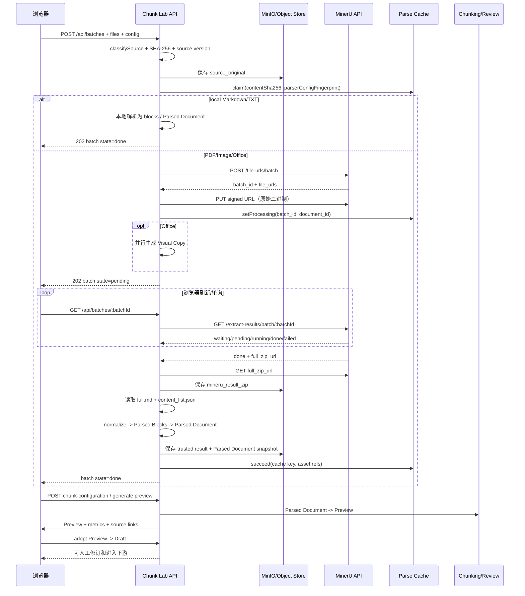

# MinerU 解析与 Chunk Lab 交互设计

本文说明当前项目如何接入 MinerU，重点回答：

- 哪些文件走 MinerU，哪些文件走本地解析？
- Chunk Lab 向 MinerU 发送了什么参数？
- MinerU 返回的 ZIP 中有哪些文件？项目实际消费哪些文件？
- 上传、提交、轮询、下载、归一化和进入 Chunk 预览之间如何交互？
- 解析缓存、失败重试、原文定位和 Office Visual Copy 如何协作？

## 1. 一句话概括

Chunk Lab 不是把 MinerU 当作“直接返回 Chunk 的服务”，而是把 MinerU 当作**带版面证据的解析器**：

```text
原始文件
  -> MinerU 解析任务
  -> ZIP 结果（Markdown + JSON + 诊断文件）
  -> Content Blocks / Parsed Document 归一化
  -> Chunk Lab Preview
  -> 人工确认 Draft
```

MinerU 的 Content Block ID 只用于来源证据；最终业务 Chunk ID 由 Chunk Lab 自己生成。

## 2. 文件路由：什么发送给 MinerU

文件类型由 `src/v21-input.ts:119` 的 `classifySource()` 决定：

| 扩展名 | 解析路线 | 是否发送 MinerU | Chunk Lab 原文视图 | 额外处理 |
| --- | --- | --- | --- | --- |
| `.pdf` | `mineru` | 是 | `original_file` | 建立 PDF 页尺寸和 bbox 坐标映射 |
| `.png/.jpg/.jpeg` | `mineru` | 是 | `original_file` | 以原始图片作为来源视图 |
| `.docx/.pptx/.xlsx` | `mineru` | 是 | 优先 `visual_copy` | 独立生成 Office Visual Copy；失败不阻塞 MinerU 解析 |
| `.md` | `local` | 否 | `markdown_source` | CommonMark/本地块化 |
| `.txt` | `local` | 否 | `txt_source` | 本地文本块化 |
| 其他扩展名 | 拒绝 | 否 | 无 | 返回“不支持的文件格式” |

Office 文件有两条并行路径：

```text
Office 原始字节 ──> MinerU（正式解析输入）
             └──> Visual Copy（用于版面浏览，不替代 MinerU）
```

Visual Copy 失败时，文档会记录 `visual_copy_unavailable` 质量标记，但 Parsed Document、Chunking、审核和导出仍可继续。不能把 Visual Copy 当成 MinerU 的输入，也不能用它静默替代解析结果。

## 3. Chunk Lab 的上传与 MinerU 交互

### 3.1 浏览器提交

前端在 `app.js` 中将解析配置作为 multipart 字段 `config` 发送到：

```http
POST /api/batches
Content-Type: multipart/form-data
```

配置字段的形状是：

```json
{
  "modelVersion": "vlm",
  "language": "ch",
  "isOcr": false,
  "enableTable": true,
  "enableFormula": true
}
```

当前服务端默认值（`src/server.ts:4304`）：

| 参数 | 默认值 | 作用 |
| --- | --- | --- |
| `modelVersion` | `vlm` | MinerU 解析模型路线，允许 `vlm` 或 `pipeline` |
| `language` | `ch` | 文档语言配置 |
| `isOcr` | `false` | 是否按 OCR 路径处理 |
| `enableTable` | `true` | 是否启用表格处理 |
| `enableFormula` | `true` | 是否启用公式处理 |

服务端不会直接信任浏览器提交的派生状态。它只解析这几个配置字段，并重新计算内容哈希、来源版本和解析配置指纹。

### 3.2 先保存原始文件

收到上传后，Chunk Lab 先做以下工作：

1. 校验文件扩展名和路由。
2. 读取文件字节并计算 `contentSha256`。
3. 将原始文件写入对象存储，资产类别为 `source_original`。
4. 记录 `sourceDocumentVersion`。
5. PDF 额外读取页尺寸、旋转和 MediaBox/CropBox，建立来源坐标映射。
6. 对 Office 文件启动独立 Visual Copy。

原始文件不会直接塞进 PostgreSQL；数据库只保存对象引用、哈希、状态和元数据。

### 3.3 解析缓存与去重

对 PDF、Office 和图片，服务端用以下组合标识一次可复用的 MinerU 解析：

```text
(content_sha256, parser_config_fingerprint)
```

`parser_config_fingerprint` 由以下字段组成：

```json
{
  "parser_version": "mineru-api-v4",
  "model_version": "vlm",
  "language": "ch",
  "enable_table": true,
  "enable_formula": true,
  "is_ocr": false
}
```

当相同文件和相同配置正在解析时，新的上传会复用 in-flight 任务；已成功的解析直接复用已保存结果；失败记录允许后续重试。这样避免因为重复上传或浏览器重试而重复提交 MinerU。

## 4. 服务端到 MinerU 的实际请求

### 4.1 申请批量上传地址

`src/mineru.ts:64` 调用 MinerU API v4 的批量上传入口：

```http
POST /file-urls/batch
Authorization: Bearer <server-side-token>
Content-Type: application/json
```

请求体的实际字段：

```json
{
  "files": [
    {
      "name": "产品说明书.pdf",
      "data_id": "<Chunk Lab document id>",
      "is_ocr": false
    }
  ],
  "model_version": "vlm",
  "language": "ch",
  "enable_formula": true,
  "enable_table": true
}
```

这里的 `data_id` 是 Chunk Lab 为文档生成的稳定标识，不是最终 Chunk ID。服务端 token 只在服务端环境中使用；日志中的 MinerU 响应会经过脱敏，不保存 Authorization、API Key、Cookie 或签名 URL。

### 4.2 上传原始字节

MinerU 返回 `batch_id` 和每个文件对应的 `file_urls` 后，Chunk Lab 对每个 URL 发起：

```http
PUT <signed-upload-url>
Body: 原始文件二进制
```

多个文件并行上传。某个文件失败只标记该文档失败，不覆盖同一批次中其他文档的状态。

### 4.3 轮询批次状态

前端刷新或访问以下接口时，服务端负责向 MinerU 轮询：

```http
GET /api/batches/:batchId
```

服务端内部调用：

```http
GET /extract-results/batch/:mineruBatchId
Authorization: Bearer <server-side-token>
```

MinerU 单文件状态映射为：

| MinerU 状态 | Chunk Lab 状态 | 含义 |
| --- | --- | --- |
| `waiting-file` / `pending` | `pending` | 等待文件或等待处理 |
| `running` / `converting` | `running` | 正在解析或转换 |
| `done` | 下载 ZIP 并归一化 | 解析完成 |
| `failed` | `failed` | 保存错误原因和诊断分类 |

如果返回 `extract_progress`，Chunk Lab 会保存已提取页数和总页数，供界面显示进度。解析完成但没有 `full_zip_url` 时，会标记为 `mineru_result_anomaly`，而不是假装解析成功。

## 5. MinerU ZIP 输出什么文件

不同 MinerU 版本和后端的 ZIP 内容可能略有差异。项目按“原始结果保全、可信结果归一化”的原则处理。

### 5.1 常见输出文件

| 文件 | 典型用途 | Chunk Lab 当前处理 |
| --- | --- | --- |
| `full.md` | 按阅读顺序生成的 Markdown 派生文本 | **必需读取**；缺失则结果异常 |
| `content_list.json` | 内容块类型、文本、页码、bbox、图片路径等 | 当前适配器优先读取并归一化 |
| `content_list_v2.json` | 较新的统一内容列表格式 | 原始 ZIP 保留；当前 `src/mineru.ts` 的直接匹配逻辑是 `content_list.json`，接入新版本需做版本适配 |
| `middle.json` | 更接近中间结构，适合诊断和二次开发 | 原始 ZIP 保留，不直接作为 Chunk 输入 |
| `*_layout.pdf` | 带布局框和阅读顺序的质检 PDF | 原始 ZIP 保留，用于人工对照 |
| `*_span.pdf` | 文本/公式 span 可视化（依后端提供） | 原始 ZIP 保留，用于诊断 |
| `images/*` | 图片裁剪或图片资源 | 通过可信资产流程使用；路径字符串本身不是可展示资产 |
| 其他 JSON/日志 | 版本相关诊断信息 | 只按 allowlist 保留，不能进入普通检索输入 |

**重要实现细节：** `downloadMineruResult()` 会在 ZIP 中查找 `full.md`，并用正则查找以 `content_list.json` 结尾的文件；它不会把 `middle.json` 或所有 JSON 自动拼成 Chunk。完整 ZIP 会作为 `mineru_result_zip` 对象保存，可信归一化结果另存为 `mineru_trusted_result`。

### 5.2 结果资产

解析完成后，Chunk Lab 可能保存这些对象：

```text
source_original          原始上传文件
mineru_result_zip        MinerU 完整 ZIP，供诊断/追溯
mineru_trusted_result    脱敏后的 Markdown + Parsed Blocks + raw content list
parsed_document_snapshot V2.1 Parsed Document 快照
office_visual_copy       Office 的独立版面浏览 PDF（如果生成成功）
mineru_raw_response      脱敏后的提交/轮询响应
```

对象引用包含 bucket、object key、checksum、asset class 和版本；数据库或公开响应不保存过期签名 URL、凭证、Authorization 或 Base64。

## 6. 从 MinerU 内容列表到 Parsed Blocks

`normalizeMineruContentList()` 将 MinerU 内容列表转换为应用统一的 `ParsedBlock`：

| MinerU 字段 | 应用字段 | 处理规则 |
| --- | --- | --- |
| `type` | `type` | 包含 `table` -> `table`；包含 `image` -> `image`；其他 -> `text` |
| `table_body` / `text` | `text` | 表格优先取 `table_body` |
| `image_caption` / `text` | `text` | 图片优先拼接图注；没有图注时取文本 |
| `page_idx` | `page` | 0-based 转为 1-based |
| `bbox` | `bbox` | 转成数字数组 |
| `readingOrder` / `reading_order` / `order` | `readingOrder` | 没有时使用数组索引 |
| `parentId` / `parent_id` | `parentId` | 可选保留 |
| `groupId` / `group_id` | `groupId` | 可选保留 |
| `productIdentity` / `product_identity` | `productIdentity` | 可选保留，不假设一定存在 |
| `img_path` | `imagePath` | 保留为来源线索，不等于可信图片资产 |

应用会生成自己的 ID：

```text
MinerU item -> b-1 / b-2 / b-3（Parsed Block ID）
                 |
                 v
        flow-1-1 / image-group-1-1（业务 Chunk ID）
```

如果 ZIP 没有可用内容列表但存在 `full.md`，当前实现会按空行将 Markdown 降级拆成文本块，并把页码和 bbox 置空；这会降低来源定位质量，因此应在展示中说明这是异常降级路径，不是理想解析结果。

## 7. Parsed Document 如何进入 Chunk Lab

归一化后的结果进入 `buildMineruParsedDocument()`，形成 V2.1 Parsed Document。它保留：

- 原始来源版本和解析器版本。
- Content Blocks 的统一类型和阅读顺序。
- 页码、bbox、坐标单位和 PDF 页面映射。
- 原始、normalized、display、searchText 等内容层。
- 表格、图片、公式、代码、警告、图注等受保护类型。
- 后续 Chunk 使用的 Source Segments。

然后用户在 Chunk Lab 中选择切分策略：

```text
Parsed Document
  -> Sentence / Token / Structure-Aware / Semantic Boundary
  -> Preview
  -> 查看 Token、过短/过长、跨页、图片/表格和来源高亮
  -> 点击“采用此 Preview”
  -> Draft
```

MinerU 只提供候选结构；Preview 是 Chunk Lab 计算出来的可替换提案；Draft 才是允许人工修订、Context、Embedding 和数据库写入的阶段。

## 8. PDF 坐标和原文定位

MinerU 内容列表常使用归一化的 `1000 x 1000` bbox，而 PDF 页面使用实际点数和页面旋转。Chunk Lab 在上传 PDF 时用 PDF.js 读取每页尺寸，建立：

```text
MinerU normalized bbox
  -> PDF page width/height + rotation
  -> trusted source location
  -> 原文框与 Chunk 双向高亮
```

如果 bbox 或页码超出可信映射，会记录 `bbox_page_anomaly`。不能把异常坐标默认为正确，也不能通过截断 bbox 来掩盖来源问题。当前修复保持原始证据不变，只修正归一化坐标到 PDF 的映射。

## 9. 完整交互时序图



## 10. 失败、重试和状态恢复

| 情况 | 系统行为 |
| --- | --- |
| MinerU 上传某个文件失败 | 只标记该文档失败，其他文档继续 |
| MinerU 解析失败 | 保存 `failed`、错误消息和诊断分类 |
| 解析完成但无 ZIP URL | 标记 `mineru_result_anomaly` |
| ZIP 无 `full.md` | 下载/归一化失败，不生成可信结果 |
| ZIP 无 `content_list.json` | 可使用 Markdown 降级块，但来源页码/bbox 为空，质量降低 |
| 轮询暂时失败 | 保留当前任务状态，下次访问继续轮询 |
| 解析超时 | 标记失败并更新 Parse Cache |
| 相同内容和配置再次上传 | 复用成功结果或 in-flight 任务 |
| 确认后重新解析 | 清理 Parsed Document、Preview、Draft 和派生审核状态，重新建立链路 |
| Office Visual Copy 失败 | 保留质量标记，MinerU 解析和下游仍可继续 |

页面刷新时，Chunk Lab 从服务端恢复批次、Parsed Document、Preview/Draft 和下游任务；浏览器不被视为唯一状态源。

## 11. 面试 STAR 讲法

**Situation**：不同文档格式和 MinerU 后端返回的数据结构不完全一致，直接把 Markdown 或原始 JSON 当 Chunk 会丢掉页码、bbox、表格和图片来源。

**Task**：把 MinerU 接入成一条可重试、可缓存、可追溯的解析链路，并让解析结果安全进入 Chunk 审核工作台。

**Action**：我先按扩展名做路由，Office 原始字节直接送 MinerU，同时独立生成 Visual Copy；提交时用文件 SHA-256 加解析配置指纹做缓存；轮询完成后保存完整 ZIP，再从 `full.md` 和内容列表归一化出 Parsed Blocks；最后通过 PDF 坐标映射和 Source Segments 把 Chunk 重新连回原文。

**Result**：解析结果不会直接绕过 Preview/Draft 门禁进入 Embedding。解析失败、ZIP 异常、Visual Copy 失败和重复上传都有独立状态和恢复路径；真实 PDF 验收覆盖 23 页、257 个 source blocks 和 55 个 Draft Chunks。这里的结果是当前项目的本地/production-like 验收，不等同于所有 MinerU 版本和线上生产部署都已验证。

## 12. 关键代码入口

| 责任 | 文件/位置 |
| --- | --- |
| 文件类型路由 | `src/v21-input.ts:119` |
| 浏览器上传与配置 | `app.js:179`、`src/server.ts:1942` |
| MinerU 提交和上传 | `src/mineru.ts:64` |
| MinerU 轮询 | `src/mineru.ts:116`、`src/server.ts:2164` |
| ZIP 解压和可信结果 | `src/mineru.ts:254` |
| 状态转换和结果应用 | `src/parse-lifecycle.ts:35` |
| 解析缓存指纹 | `src/parse-cache.ts:49` |
| Parsed Document 构建 | `src/server.ts:4546` |
| PDF 坐标映射 | `src/server.ts:4560` |
| Preview/Draft 生成 | `app.js:420`、`app.js:455` |
| MinerU 结果和对象资产持久化 | `src/server.ts:2198`、`src/server.ts:4705` |

## 13. 展示时的边界

- 当前适配器明确要求 ZIP 中有 `full.md`；对于 `content_list_v2.json` 等版本差异，应在生产接入时增加版本化适配，不要声称所有版本自动兼容。
- MinerU 的布局、OCR、表格和 VLM 输出都是机器候选结构，不能替代人工审核。
- `imagePath` 或 `img_path` 只是解析字段，只有经过可信资产校验的图片才能发送给应用图片 VLM。
- Chunk Lab 当前项目整体仍有 `in_progress` 范围；本地验收证据不能表述为线上生产部署完成。

