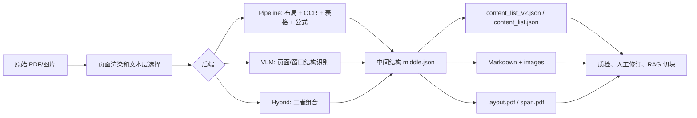

# MinerU 本地部署、人工质检与 RAG 接入说明

> 研究日期：2026-08-13。本文依据 MinerU 当前 `master` 分支及官方中文文档；模型名称、输出 JSON 格式和默认后端会随版本变化，生产接入时必须把实际 MinerU 版本写入解析记录。

## 先给结论

1. **可以离线部署，但不能仅靠配置任意替换 OCR 或 VLM。** `MINERU_MODEL_SOURCE=local` 的含义是从本地路径加载 MinerU 官方模型仓库的文件；它不是一个通用的“填写任意 Hugging Face OCR/VLM 名称”的开关。
2. 当前公开入口可选择 `pipeline`、`vlm-engine`、`hybrid-engine`（默认）及相应 HTTP client；这是**解析后端/推理引擎选择**，不是任意模型替换。VLM 的本地实现也直接使用 Qwen2-VL 类和 MinerU 专用 `mineru_vl_utils` 输出协议。
3. Gradio 是“上传、提交、预览、下载”的操作台，并非人工标注或 Markdown 编辑器。源码中的 Markdown 文本框是 `interactive=False`；页面没有保存修改后 Markdown 的回写链路。
4. MinerU 对图文、表格、公式、页眉页脚等有模型和后处理，但输出应当视为**带证据的候选结构**。质检应看 `*_layout.pdf`、原 PDF、`*_content_list_v2.json`/`*_middle.json`，修订后再生成可索引版本；不要只盯着最终 `.md`。
5. 为 RAG 切块，优先消费 `content_list_v2.json` 的块类型、页码/坐标和标题层级，Markdown 用作渲染与文本来源。跨页表、多栏顺序、表格 HTML、公式、图注和页眉页脚都需要保留 provenance 和单独策略。

## 1. 本地部署时究竟运行了什么

MinerU 的入口已经服务化：`mineru` 命令在未传 `--api-url` 时会拉起临时本地 `mineru-api`；也可常驻运行 `mineru-api`、`mineru-gradio`，或用 `mineru-router` 聚合多服务/多 GPU。Gradio 未传 `--api-url` 时也会复用或启动本地 API。因此“本地 CLI / 本地 Gradio / 服务器 FastAPI”主要是**同一解析能力的不同调用方式**，不是不同的解析产品。

当前命令公开的本地后端是：

| 后端 | 主要工作 | 适合怎样理解 |
| --- | --- | --- |
| `pipeline` | 布局、OCR、表格、公式等专用模型串成流水线 | 由多种固定组件共同产生结构；OCR 语言参数仅对它公开。 |
| `vlm-engine` | MinerU VLM 直接按页面/窗口理解文档 | 用 MinerU VLM 和其规定的结构化输出协议。 |
| `hybrid-engine`（默认） | VLM 与小模型流水线组合 | 不是“任意 VLM + 任意 OCR”的拼装器。 |
| `vlm-http-client` / `hybrid-http-client` | MinerU 客户端调用 OpenAI 兼容的远端 VLM 服务 | 可把 VLM 推理放到另一台服务器；远端仍须提供 MinerU 所需的模型能力和输出兼容性。 |

`mineru-openai-server` 只是在 VLM 前面提供 OpenAI 兼容服务，并使用 vLLM 或 LMDeploy 加速；它不代表可以把模型随意换成普通聊天 VLM。

### 1.1 `local` 的真实边界

官方模型源支持 Hugging Face、ModelScope、`local`。`local` 读取用户目录 `mineru.json` 的：

```json
{
  "models-dir": { "pipeline": "<本地 pipeline 根目录>", "vlm": "<本地 VLM 根目录>" },
  "model-source": "auto"
}
```

官方 `mineru-models-download` 下载的对象也被写死为两组官方仓库：

- Pipeline：`opendatalab/PDF-Extract-Kit-1.0`，其中有 PP-DocLayoutV2、Paddle OCR 权重、表格结构模型、公式模型等；
- VLM：`opendatalab/MinerU2.5-Pro-2605-1.2B`。

因此，下载后拷贝到内网盘、离线机器或服务器，并把上述路径填入 `models-dir`，是受官方支持的本地化方式。切换 Hugging Face/ModelScope 只改变**下载来源**，不改变模型架构或权重。

### 1.2 OCR 能不能换

**以官方配置/CLI 计：不能替换为任意 OCR。** Pipeline 初始化代码固定实例化 `PytorchPaddleOCR`，并由布局、表格、公式模块共同依赖其 span、坐标和语言行为。公开的 `-l/--lang` 是选择 MinerU 支持的 OCR 语言模型，不是填写其它 OCR 实现；`--method txt|ocr|auto` 是选择文本层/OCR 路径，也不是选择引擎。

官方确实有一个受限的公式模型切换：环境变量 `MINERU_FORMULA_CH_SUPPORT=true` 会把 pipeline 的公式模型从默认 `unimernet_small` 换成 `pp_formulanet_plus_m`。这是仓库内已有的特定开关，不能外推为 OCR/VLM 任意替换。

若一定要接入 PaddleOCR 之外的 OCR，至少需要自行维护适配层，使其产生 MinerU 后处理要求的检测框、文本、置信度、阅读顺序和坐标语义，并用真实文档回归表格/公式/双栏。那是 fork 的工程工作，升级 MinerU 时需要重新合并与验证；不是部署参数。

### 1.3 VLM 能不能换

**以本地 `vlm-engine` / `hybrid-engine` 计，默认模型不是可任意替换的。** 源码的 transformers 分支直接加载 `Qwen2VLForConditionalGeneration`，并把结果交给 MinerU 的 `MinerUClient`，该客户端启用了表格/公式包装、图片分析和跨页表合并。即使某个其它 VLM 可以被 vLLM/LmDeploy 启动，也不保证它能理解 MinerU 提示词、返回所需的页面块 JSON、坐标和标签。

HTTP client 是较合理的“部署分离”方式：在 GPU 服务器启动 MinerU OpenAI server，客户端用 `vlm-http-client` 或 `hybrid-http-client` 指向它。`MINERU_VL_MODEL_NAME` 可在远端服务同时托管多个模型时指定名称，`MINERU_VL_API_KEY` 可用于认证；这仍是指向一个与 MinerU 协议兼容的服务，而非官方承诺的任意模型兼容。

如果要评估替代 VLM，应把它当作一个新解析器版本：固定测试集，比较阅读顺序、表格结构、公式 LaTex、图注绑定、页眉脚误入率和跨页连续性；未通过这些验收前不要直接进入 RAG 索引。

## 2. 复杂版面是如何变成 Markdown 的

下面的流程适用于 PDF 的核心情况；DOCX/PPTX/XLSX 有各自 office 后端，不能把 PDF 的视觉识别规则原样套用。



| 文档现象 | MinerU 的机制与输出 | 不能保证的部分 | 质检重点 |
| --- | --- | --- | --- |
| 图文混排、图表、图注/脚注 | 布局/ VLM 块类型含 `image`、`chart`、caption、footnote；多模态 Markdown 引用截图，内容可折叠附在图后。 | 图注可能绑定错图；图中细小文字/语义分析可能缺失。 | `layout.pdf` 的框与顺序；`content_list_v2` 中图片、caption、页码、图片路径的关联。 |
| 有线/无线表格 | Pipeline 有表格分类与两类表格模型；VLM 输出 `table`，Markdown/结构化输出可包含 `table_body` HTML。 | 单页结构识别不等于逻辑数据正确，复杂合并单元格最易错。 | 原页与 HTML 单元格、表题表注、列数、空单元格、表格截图。 |
| 跨页表 | VLM 客户端构造时已启用 `enable_cross_page_table_merge=True`；CLI 也有 `MINERU_TABLE_MERGE_ENABLE` 开关。 | 官方资料没有承诺所有跨页表均能正确拼接，尤其是续表无表头、页末断行、跨栏/跨向时。 | 两页交界处：续表识别、表头继承、行是否重复/丢失；需要能回链两页的来源。 |
| 双栏/多栏 | 布局模型输出阅读顺序；`layout.pdf` 每个框右上数字就是阅读顺序。 | 栏间浮图、脚注、跨栏标题可能令顺序错乱。 | 同页连续正文是否先读完整左栏再读右栏；不能只按 PDF 抽取文本顺序判断。 |
| 行内/行间公式 | Pipeline 有公式检测/识别；内容列表使用 LaTex，如 `equation` 的 `text_format: latex`。 | 特殊字体、低清扫描、编号绑定、中文公式等会错；公式可关闭，不能把禁用后的图当作可检索公式。 | `span.pdf`（pipeline）和源页；LaTex 是否可渲染、变量/上下标/编号是否正确。 |
| 页眉、页脚、页码、页脚注 | 输出类型明确标为 `header/footer/page_number/page_footnote`；中间结果中放入 `discarded_blocks`，VLM 的内容列表仍可保留这些结构。 | 可能误分类为正文，或正文误丢弃。 | 确认它们未进入正文切块；若文档业务上页脚有关键条款，应显式白名单而不是默认丢弃。 |

“支持识别”不是“每个样本都无误”。模型做的是版面/视觉推断，后处理再依据类型、位置和阅读序合成 Markdown；所以原始 PDF 仍是事实来源，`middle.json`/`content_list_v2.json` 是机器的带坐标判断，Markdown 是一个便于消费的派生表示。

## 3. Gradio 为什么不能直接做人工修订，人工应该在哪介入

当前 Gradio 代码的结果区只有：Markdown 渲染预览、只读 `gr.Code(language="markdown", interactive=False)` 文本、只读 JSON、原 PDF 预览和一个包含整个结果目录的 ZIP 下载。也就是说，浏览器页面没有可保存的编辑状态、版本、审核记录或“修改后重建 JSON/Markdown”的服务端接口。

这不是异常，而是职责边界：MinerU 负责抽取和可视化诊断，不提供文档标注/审核产品。可执行的人工闭环是：

1. **解析保全。** 每次任务保留原文件的不可变副本、MinerU 版本/后端/模型配置、完整输出目录。API 默认仅保留任务和输出 24 小时，生产环境要把成品归档到持久存储。
2. **自动初筛。** 根据文件类型和规则标记风险，例如：`layout.pdf` 中顺序异常、表格跨页、公式块、二栏页、`header/footer` 混入、空表格 HTML、或解析缺少标题层级。规则应标为“需要检查”，不要虚构模型置信度为质量结论。
3. **人工对照。** 审核者同时看原 PDF、`layout.pdf` 和 Markdown/结构化内容：修正阅读顺序、表格 HTML/Markdown、公式 LaTex、图注归属和业务上重要的页脚。
4. **修订生成物，而非覆盖原始证据。** 推荐保存 `source/`（原 MinerU 输出）与 `reviewed/`（人工确认后的 Markdown/结构化块）两套，并记录 `parser_version`、`review_status`、`reviewer`、时间和每个块的 `page_idx/bbox`。不要改完 `.md` 后丢掉 JSON/PDF，届时无法追溯一句话来自哪页哪块。
5. **仅索引已通过门槛的版本。** 修订会改变文本和切块边界，需用新的 `document_revision_id` 重切块并替换/失效旧向量，避免相同资料的机器版和人工版同时被召回。

若希望在浏览器内编辑，应把它当作 RAG 系统自己的 review workbench：读取并编辑块级 canonical JSON，展示 PDF 页和 bbox，高亮差异，保存修订历史；保存后由同一份 canonical JSON 再渲染 Markdown。仅给 Markdown 加一个 textarea 很快，但会丢失块、页码、坐标、表格和图片的对应关系，不适合作为长期方案。

## 4. 面向 RAG 切块的接入建议

### 4.1 不把 Markdown 当唯一输入

建议建立 canonical document record：

```text
原始文件 + MinerU 完整输出目录
    -> content_list_v2 / middle.json（结构、页码、bbox、类型）
    -> reviewed canonical blocks（可选人工修订）
    -> Markdown 渲染/文本规范化
    -> semantic chunks + provenance
```

优先选 `content_list_v2.json`，因为 3.0 起所有后端同时生成它，按页分组、统一 `type + content`；但官方明确其“开发中，格式可能调整”。因此摄入层必须按 MinerU 版本做 schema 校验与适配，不能把字段名永久硬编码到切块器中。旧的 `content_list.json` 适合阅读顺序平铺，`middle.json` 适合需要原始块层级和 discarded blocks 的二次开发。

### 4.2 切块的最小规则

| 块类型 | 推荐索引策略 | 必带元数据 |
| --- | --- | --- |
| 标题 + 普通段落 | 用标题路径聚合，在 token 上限处按段落/句子切；不要把标题单独变成孤儿 chunk。 | `document_revision_id`, `section_path`, `page_idx`, `bbox`, `source_block_ids` |
| 表格 | 表题、表注、页码与表体作为一个语义单元；表过大时按行拆，并给每个子块重复表头/表题。保留 HTML 或规范化 Markdown，同时保留截图路径。 | 表格 ID、跨页来源页列表、表头、行区间、`review_status` |
| 跨页表 | 只有经规则或人工确认连续时才合并；否则以“表 A（第 n 页）/表 A 续（第 n+1 页）”分别存并双向关联。 | `continuation_of`, `page_idx[]`, 合并理由/审核记录 |
| 公式 | 保留原 LaTex + 周边解释段落；不要将公式字符硬切。必要时另存渲染图路径供多模态检索。 | `formula_latex`, 页码/框、解析/审核状态 |
| 图片/图表 | 文本 RAG 至少索引图题、图注、相邻解释；是否索引图内语义取决于图片分析结果质量，不应凭空补写。 | 图片路径、caption、页码/框、分析状态 |
| 页眉页脚/页码 | 默认不进正文向量；有法律版本号、保密级别等业务价值时，进入独立 metadata 或专门 chunk。 | 原始类型、保留/丢弃原因 |

对用户关心的双栏和跨页表，关键不是“切块器能否再猜对”，而是**在切块前固定正确的阅读顺序和表格连续关系**。如果 MinerU 已经错误地把左右栏交错，或将两页表合错，纯文本切块通常无法可靠恢复；这应在解析质检层修正。

### 4.3 可量化的准入门槛

先拿一组代表性文档（单栏、双栏、扫描件、复杂表、跨页表、公式密集、图文混排）做固定 golden set。每次升级 MinerU、换模型目录、换后端或改审核规则，都对比：

- 标题层级和章节归属；
- 每页正文阅读顺序；
- 表格行/列、合并单元格、跨页续接；
- 公式 LaTex 可渲染率与关键公式正确性；
- 页眉页脚误入正文率；
- 图题/表题与主体绑定；
- RAG chunk 的页码、bbox、源块回链完整率。

没有通过这些针对业务资料的验收，就应把输出状态标为 `needs_review`，而不是直接声称“已可用于 RAG”。

## 官方依据与定位入口

- [官方模型源配置](https://opendatalab.github.io/MinerU/zh/usage/model_source/)：`MINERU_MODEL_SOURCE`、`models-dir`、本地模型路径和下载行为。
- [官方基础使用](https://opendatalab.github.io/MinerU/zh/usage/quick_usage/)：CLI/API/Gradio/router、HTTP client、任务保留时间、配置项。
- [官方 CLI 说明](https://opendatalab.github.io/MinerU/zh/usage/cli_tools/)：当前后端、默认 `hybrid-engine`、OCR 语言和表格/公式开关。
- [官方输出文件说明](https://opendatalab.github.io/MinerU/zh/reference/output_files/)：`layout.pdf`、`span.pdf`、Markdown、`content_list*.json`、`middle.json` 的字段和用途。
- [官方 Docker 部署](https://opendatalab.github.io/MinerU/zh/quick_start/docker_deployment/)：Linux/WSL2 Docker、vLLM/LMDeploy 和服务入口。
- [当前仓库的模型下载实现](https://github.com/opendatalab/MinerU/blob/master/mineru/cli/models_download.py) 与 [模型源实现](https://github.com/opendatalab/MinerU/blob/master/mineru/utils/models_download_utils.py)：官方固定下载的 pipeline/VLM 模型组和 `local` 路径逻辑。
- [当前 Pipeline 初始化](https://github.com/opendatalab/MinerU/blob/master/mineru/backend/pipeline/model_init.py)：PytorchPaddleOCR、版面/表格/公式组件以及受限公式切换。
- [当前 VLM 初始化](https://github.com/opendatalab/MinerU/blob/master/mineru/backend/vlm/vlm_analyze.py)：Qwen2-VL 加载分支、MinerUClient、跨页表合并和模型路径。
- [当前 Gradio 实现](https://github.com/opendatalab/MinerU/blob/master/mineru/cli/gradio_app.py)：结果预览、只读 Markdown/JSON 文本和 ZIP 下载流程。

