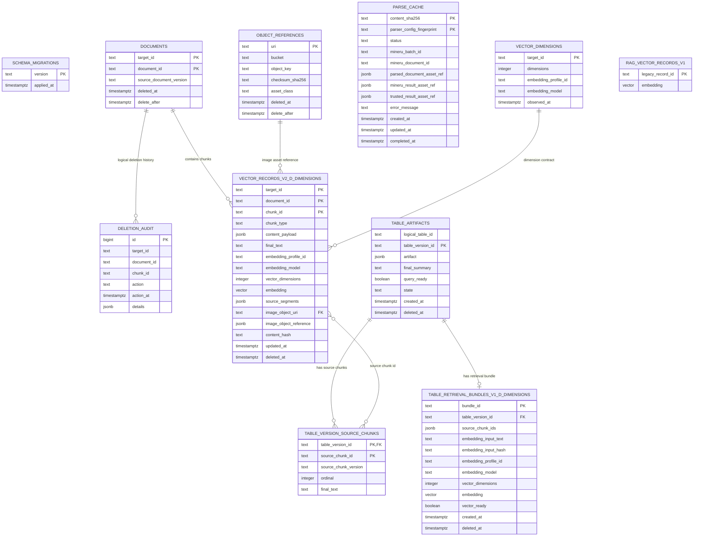

# RAG PostgreSQL / pgvector 表结构参考

本文档面向后续维护、数据分析和 RAG 检索开发人员，说明当前代码实际创建和使用的 PostgreSQL 表。

## 1. 存储边界

文档二进制和 MinerU 文件结果不直接存入 PostgreSQL：

- 原始文件、MinerU ZIP、可信结果和 Parsed Document 快照存放在远程 MinIO/对象存储。
- PostgreSQL 只保存状态、指纹、结构化元数据、向量和对象引用。
- `s3://...` 是持久化对象引用；数据库不应保存过期签名 URL、凭证、Authorization、base64 或二进制内容。
- 上传并完成 MinerU 解析不会自动写入向量表。必须先完成 Chunk、Embedding，再显式执行数据库写入任务。

## 2. 表总览

| 表 | 用途 | 是否包含向量 |
| --- | --- | --- |
| `rag.schema_migrations` | 记录已应用的迁移版本 | 否 |
| `rag.documents` | 向量记录的文档父表 | 否 |
| `rag.object_references` | 向量记录引用的对象元数据 | 否 |
| `rag.parse_cache` | MinerU 解析缓存和任务状态 | 否 |
| `rag.vector_dimensions` | 每个向量目标的维度/模型契约 | 否 |
| `rag.deletion_audit` | 向量软删除和物理删除审计 | 否 |
| `rag.vector_records_v2_d<dimensions>` | 普通 Chunk 向量记录 | 是 |
| `rag.table_artifacts` | 结构化表格版本和审核状态 | 否 |
| `rag.table_version_source_chunks` | 表格版本与来源 Chunk 的关系 | 否 |
| `rag.table_retrieval_bundles_v1_d<dimensions>` | 表格检索 Bundle 向量 | 是 |
| `rag_vector_records_v1` | 旧版兼容向量表 | 是，历史格式 |

其中 `<dimensions>` 是 Embedding 向量维度。当前已验证的生产-like契约是 `1024`，因此普通向量表为：

```text
rag.vector_records_v2_d1024
```

表格检索向量表为：

```text
rag.table_retrieval_bundles_v1_d1024
```

## 3. 迁移账本：`rag.schema_migrations`

| 字段 | 类型 | 含义 |
| --- | --- | --- |
| `version` | `text`，主键 | 迁移版本标识 |
| `applied_at` | `timestamptz` | 迁移应用时间 |

当前相关版本包括普通向量维度版本、GC 审计版本和表格检索版本。应用迁移使用 `ON CONFLICT DO NOTHING`，可重复执行。

## 4. 文档父表：`rag.documents`

这是普通向量记录的父表，不是上传批次的完整 Source Document 表。

| 字段 | 类型 | 含义 |
| --- | --- | --- |
| `target_id` | `text` | 向量数据库目标/配置标识 |
| `document_id` | `text` | Parsed Document/业务文档标识 |
| `source_document_version` | `text`，可空 | 来源文档版本；当前普通向量写入路径可能不填充 |
| `deleted_at` | `timestamptz`，可空 | 文档软删除时间 |
| `delete_after` | `timestamptz`，可空 | 允许物理清理的时间 |

主键是：

```text
(target_id, document_id)
```

普通向量表通过外键引用这组主键。

## 5. 对象引用表：`rag.object_references`

只保存对象元数据，不保存文件内容。

| 字段 | 类型 | 含义 |
| --- | --- | --- |
| `uri` | `text`，主键 | 对象稳定引用，例如 `s3://bucket/key` |
| `bucket` | `text` | 对象存储桶 |
| `object_key` | `text` | MinIO 对象键 |
| `checksum_sha256` | `text` | 对象内容 SHA-256 |
| `asset_class` | `text` | `source_original`、`parsed_document_snapshot` 等资产类别 |
| `deleted_at` | `timestamptz`，可空 | 对象软删除时间 |
| `delete_after` | `timestamptz`，可空 | 允许 GC 的时间 |

普通向量记录中的 `image_object_uri` 引用 `rag.object_references(uri)`。

## 6. MinerU 解析缓存：`rag.parse_cache`

该表按“文件内容 + 解析配置”唯一识别一次解析任务。文件名、扩展名、路径、batchId、documentId 和上传者不参与唯一键。

唯一键：

```text
(content_sha256, parser_config_fingerprint)
```

| 字段 | 类型 | 含义 |
| --- | --- | --- |
| `content_sha256` | `text` | 文件二进制内容 SHA-256 |
| `parser_config_fingerprint` | `text` | 解析配置摘要 SHA-256 |
| `status` | `text` | `pending`、`processing`、`succeeded`、`failed` |
| `mineru_batch_id` | `text`，可空 | 远程 MinerU batch ID |
| `mineru_document_id` | `text`，可空 | 远程 MinerU document/data ID |
| `parsed_document_asset_ref` | `jsonb`，可空 | Parsed Document 快照的 MinIO 资产描述 |
| `mineru_result_asset_ref` | `jsonb`，可空 | MinerU ZIP 结果的 MinIO 资产描述 |
| `trusted_result_asset_ref` | `jsonb`，可空 | 归一化可信结果资产描述 |
| `error_message` | `text`，可空 | 最近一次失败原因 |
| `created_at` | `timestamptz` | 首次创建时间 |
| `updated_at` | `timestamptz` | 最近更新时间 |
| `completed_at` | `timestamptz`，可空 | 成功或失败完成时间 |

配置指纹包含：`parser_version`、`model_version`、`language`、`enable_table`、`enable_formula`、`is_ocr`。

并发上传通过唯一约束和 `INSERT ... ON CONFLICT DO NOTHING` 抢占；查询到 `pending/processing` 时复用原 MinerU 任务，不重复提交。

## 7. 向量维度契约：`rag.vector_dimensions`

| 字段 | 类型 | 含义 |
| --- | --- | --- |
| `target_id` | `text`，主键 | 向量目标 |
| `dimensions` | `integer` | 向量维度 |
| `embedding_profile_id` | `text` | Embedding 配置标识 |
| `embedding_model` | `text` | 实际模型版本 |
| `observed_at` | `timestamptz` | 维度契约确认时间 |

系统拒绝在同一 `target_id` 下混用不同维度。不能把不同维度的向量强行写入同一张 pgvector 表。

## 8. 普通 Chunk 向量表：`rag.vector_records_v2_d<dimensions>`

例如当前表 `rag.vector_records_v2_d1024`。

主键：

```text
(target_id, document_id, chunk_id)
```

| 字段 | 类型 | 含义 |
| --- | --- | --- |
| `target_id` | `text` | 向量目标 |
| `document_id` | `text` | 文档 ID |
| `chunk_id` | `text` | Chunk 稳定 ID |
| `schema_version` | `text` | 当前必须为 `2.0` |
| `chunk_type` | `text` | Chunk 类型，如文本、图片、表格 |
| `content_payload` | `jsonb` | Chunk 结构化内容 |
| `final_text` | `text` | 审核后的最终文本 |
| `embedding_text_hash` | `text` | 实际送入 Embedding 的文本哈希 |
| `embedding_profile_id` | `text` | Embedding 配置 ID |
| `embedding_model` | `text` | Embedding 模型 |
| `vector_dimensions` | `integer` | 必须匹配表名维度 |
| `embedding` | `vector(dimensions)` | 向量本体 |
| `source_segments` | `jsonb` | 页码、bbox、来源 Block、文本范围等溯源信息 |
| `image_object_uri` | `text`，可空 | 图片对象 URI，引用 `rag.object_references` |
| `image_object_reference` | `jsonb`，可空 | 图片资产描述快照 |
| `image_policy` | `text`，可空 | 图片处理策略 |
| `strategy_version` | `text` | Chunking 策略版本 |
| `context_version` | `jsonb` | Context 生成/确认版本信息 |
| `content_hash` | `text` | Chunk 内容哈希，用于幂等 upsert |
| `updated_at` | `timestamptz` | 最近写入时间 |
| `deleted_at` | `timestamptz`，可空 | 软删除时间 |
| `delete_after` | `timestamptz`，可空 | 物理清理时间 |

向量检索使用 HNSW cosine index，并过滤 `deleted_at IS NULL`。检索结果应同时返回 `document_id`、`chunk_id` 和 `source_segments`，才能回到原文位置。

## 9. 删除审计：`rag.deletion_audit`

| 字段 | 类型 | 含义 |
| --- | --- | --- |
| `id` | `bigint`，自增主键 | 审计记录 ID |
| `target_id` | `text` | 向量目标 |
| `document_id` | `text` | 文档 ID |
| `chunk_id` | `text` | Chunk ID |
| `action` | `text` | `soft_delete` 或 `physical_delete` |
| `action_at` | `timestamptz` | 操作时间 |
| `details` | `jsonb` | 删除范围、deleteAfter 等附加信息 |

删除采用软删除优先，延迟物理清理。检索不得只依赖应用层过滤，SQL 也应显式加入 `deleted_at IS NULL`。

## 10. 表格结构表：`rag.table_artifacts`

表格本体是结构化 Artifact，不应只依赖 Markdown 或摘要。

| 字段 | 类型 | 含义 |
| --- | --- | --- |
| `logical_table_id` | `text` | 跨版本的逻辑表 ID |
| `table_version_id` | `text`，主键 | 不可变表格版本 ID |
| `artifact` | `jsonb` | 列、行、合并单元格等权威结构 |
| `final_summary` | `text` | 审核确认的表格摘要 |
| `query_ready` | `boolean` | 是否允许深度结构化检索 |
| `query_ready_at` | `timestamptz`，可空 | 进入 query-ready 的时间 |
| `state` | `text` | `staged`、`active`、`soft_deleted` |
| `created_at` | `timestamptz` | 创建时间 |
| `deleted_at` | `timestamptz`，可空 | 删除时间 |

同一个 `logical_table_id` 可以有多个版本，但通常只有一个 active 版本参与当前检索。

## 11. 表格来源关系：`rag.table_version_source_chunks`

| 字段 | 类型 | 含义 |
| --- | --- | --- |
| `table_version_id` | `text` | 引用 `rag.table_artifacts` |
| `source_chunk_id` | `text` | 关联的文本/表格来源 Chunk |
| `source_chunk_version` | `text` | 来源 Chunk 版本 |
| `ordinal` | `integer` | 表格检索 Bundle 中的顺序 |
| `final_text` | `text` | 当时关联的最终文本快照 |

主键是 `(table_version_id, source_chunk_id)`，并保证同一表格版本内 `ordinal` 唯一。

## 12. 表格检索向量表：`rag.table_retrieval_bundles_v1_d<dimensions>`

例如当前表 `rag.table_retrieval_bundles_v1_d1024`。

| 字段 | 类型 | 含义 |
| --- | --- | --- |
| `bundle_id` | `text`，主键 | Bundle ID |
| `table_version_id` | `text`，唯一外键 | 对应的表格版本 |
| `source_chunk_ids` | `jsonb` | Bundle 涵盖的来源 Chunk ID 列表 |
| `embedding_input_text` | `text` | 实际生成向量的文本 |
| `embedding_input_hash` | `text` | 输入文本哈希 |
| `embedding_profile_id` | `text` | Embedding 配置 ID |
| `embedding_model` | `text` | Embedding 模型 |
| `vector_dimensions` | `integer` | 必须匹配表名维度 |
| `embedding` | `vector(dimensions)` | 表格 Bundle 向量 |
| `vector_ready` | `boolean` | 是否可参与表格普通检索 |
| `created_at` | `timestamptz` | 创建时间 |
| `deleted_at` | `timestamptz`，可空 | 删除时间 |

检索条件至少包括：

```sql
vector_ready = true
AND deleted_at IS NULL
AND table_artifacts.state = 'active'
AND table_artifacts.deleted_at IS NULL
```

## 13. 历史兼容表：`rag_vector_records_v1`

这是旧版数据库契约使用的表，位于 `rag` schema 之外。新代码的 schema `2.0` 使用维度专用表 `rag.vector_records_v2_d<dimensions>`，不应把新数据写回旧表，也不应删除旧表或旧数据。

## 14. 推荐检索流程

### 14.1 普通语义检索

1. 使用与目标表匹配的 Embedding profile 生成查询向量。
2. 查询 `rag.vector_records_v2_d1024`。
3. 过滤 `deleted_at IS NULL`。
4. 按 cosine distance 排序。
5. 用 `document_id`、`chunk_id`、`source_segments` 回溯来源。
6. 需要展示图片时，通过 `image_object_uri` 到对象存储读取受控资产。

### 14.2 表格普通检索

1. 查询 `rag.table_retrieval_bundles_v1_d1024`。
2. 连接 `rag.table_artifacts`。
3. 只取 active、query-ready 或 `vector_ready=true` 的记录。
4. 返回表格摘要和来源 Chunk。

### 14.3 表格深度检索

当用户需要按行、列、单元格条件检索时，不应只查向量表。应先定位 `table_version_id`，再读取 `rag.table_artifacts.artifact` 的结构化内容，并通过 `rag.table_version_source_chunks` 回溯来源。

## 15. 常用安全过滤模板

普通 Chunk：

```sql
SELECT document_id, chunk_id, final_text, source_segments, content_payload
FROM rag.vector_records_v2_d1024
WHERE deleted_at IS NULL
  AND embedding_profile_id = $1
ORDER BY embedding <=> $2::vector
LIMIT $3;
```

表格 Bundle：

```sql
SELECT b.bundle_id, b.table_version_id, a.logical_table_id,
       a.final_summary, a.artifact
FROM rag.table_retrieval_bundles_v1_d1024 AS b
JOIN rag.table_artifacts AS a
  ON a.table_version_id = b.table_version_id
WHERE b.vector_ready = true
  AND b.deleted_at IS NULL
  AND a.state = 'active'
  AND a.deleted_at IS NULL
  AND b.embedding_profile_id = $1
ORDER BY b.embedding <=> $2::vector
LIMIT $3;
```

注意：示例中的 `$2::vector` 必须是与表维度一致的向量；不要在 SQL、日志或公开 API 中返回向量本体、数据库凭证或对象签名 URL。

## 16. 当前不应假设的内容

- `rag.parse_cache` 不是向量知识库，它只负责 MinerU 解析复用。
- `rag.documents` 不是完整上传文档库，原始文件和 Parsed Document 快照仍在对象存储。
- 上传成功不代表已经完成 Embedding 或向量入库。
- 普通 Chunk 向量和表格 Bundle 向量不在同一张表。
- 不同维度的向量不共用一张表。
- 当前系统没有 MongoDB、Milvus 或 Neo4j 写入链路。

## 17. Mermaid ER 关系图

下面的图可以直接复制到支持 Mermaid 的 Markdown 查看器中渲染。`<dimensions>` 表示实际 Embedding 维度，例如当前已验证的 `1024`；对象存储中的文件不作为 PostgreSQL 表绘制。



说明：

- `DOCUMENTS` 与普通向量表通过 `(target_id, document_id)` 外键关联。
- `VECTOR_RECORDS_V2_D_DIMENSIONS.image_object_uri` 外键指向 `OBJECT_REFERENCES.uri`；图片二进制仍在 MinIO。
- `TABLE_RETRIEVAL_BUNDLES_V1_D_DIMENSIONS.table_version_id` 唯一指向一个 `TABLE_ARTIFACTS` 版本。
- `TABLE_VERSION_SOURCE_CHUNKS` 与普通向量 Chunk 的关联目前通过 ID 和版本表达，数据库没有声明跨表外键，因此图中标为逻辑关系。
- `PARSE_CACHE`、`SCHEMA_MIGRATIONS` 和历史 `RAG_VECTOR_RECORDS_V1` 当前没有声明的外键关系。
